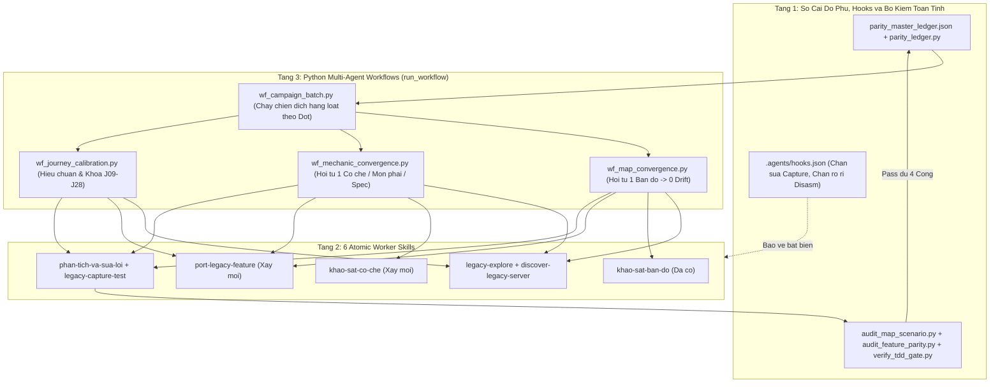

# Kế Hoạch Tổng Thể: Hệ Sinh Thái Parity Harness & Multi-Agent Workflows (`v1.0`)

Tài liệu này quy định kiến trúc tổng thể, cơ chế kiểm chứng 4 cổng (4-Gate Verification), chốt chặn chống AI gian lận (Anti-Reward-Hacking), và lộ trình triển khai hệ thống **Workflows tự động hóa** nhằm đưa **`jx-reborn-server` (`server` + `pack-tieudaotu`) đạt 100% trải nghiệm tương đương `jx-linux` (`legacy-server/bin/`)** trên client `game.exe` thực tế.

Tài liệu này kết nối trực tiếp và điều phối thực thi cho các chuẩn hiện hành của dự án:
- Hiến pháp Engine: [constitution.md](file:///d:/Projects/jx-reborn/server/.specify/memory/constitution.md)
- Quy tắc Kiểm thử Ground Truth: [ground-truth-testing.md](file:///d:/Projects/jx-reborn/workbench/.agents/rules/ground-truth-testing.md)
- Chuẩn Đối chứng Live/Record/Replay: [differential-parity-standard.md](file:///d:/Projects/jx-reborn/workbench/docs/differential-parity-standard.md)
- Kế hoạch Chuyển đổi 7,078 Lua Scripts (`Specs 031–044`): [lua-script-migration-master-plan.md](file:///d:/Projects/jx-reborn/workbench/docs/lua-script-migration-master-plan.md)
- Danh mục Hành trình Parity (`J01–J28`): [parity-journeys-backlog.md](file:///d:/Projects/jx-reborn/workbench/docs/parity-journeys-backlog.md)

---

## 1. Mục Tiêu Bắc Đẩu & Nguyên Tắc Thiết Kế Harness

> [!IMPORTANT]
> Mục tiêu cuối cùng không phải là "code biên dịch được" hay "pass vài kịch bản mẫu", mà là **mọi thao tác của người chơi trên `game.exe` (từ nhịp di chuyển 18 Hz, tốc đánh, sát thương ngũ hành, hộp thoại NPC, nhiệm vụ, vật phẩm, đến sự kiện liên server `s3relay`) đều cho phản hồi gói tin và trạng thái hội tụ y đúc `jx-linux`**.

1. **Khép kín vòng lặp (Closed-Loop Convergence)**: Chuyển từ các công cụ rời rạc (khảo sát riêng, sửa lỗi riêng) sang đường ống tự động chạy tới khi các cổng định lượng đều báo `0 Drift`.
2. **Phủ đủ 2 trục vuông góc của trải nghiệm `jx-linux`**:
   - **Trục Không gian Thế giới (World & Content Breadth)**: 139 bản đồ, NPC hội thoại, cửa hàng, rương, bẫy/cổng (`trap`), vật thể tương tác (`0x72`), chuỗi nhiệm vụ và `7,078` script `.lua` hoạt động.
   - **Trục Cảm giác Chơi & Cơ chế Hệ thống (18-Hz Feel & Engine Depth)**: Khớp từng tick 18 Hz (`55.5ms`), công thức toán học C++ chia nguyên, ngưỡng tốc đánh/xuất chiêu, đạn bay (`KMissle`), bùa chú (`KNpcAttribModify`), trang bị, tổ đội, giao dịch, PK, bang hội.
3. **Cô lập Ngữ cảnh Đa Agent (Context-Isolated Orchestration)**: Dùng Python workflows (`run_workflow`) điều phối từng Worker Agent chuyên trách một nhiệm vụ hẹp với context sạch, tránh suy giảm chất lượng do tràn ngữ cảnh (context rot).
4. **Trọng tài Cơ học Độc lập (Mechanical Verification over Self-Reporting)**: Không bao giờ tin lời tự báo cáo của LLM; mọi bước chuyển pha đều do script Python và bộ test tự động quyết định qua mã thoát (`Exit Code`) và kiểm tra `git diff`.
5. **Tuân thủ Tuyệt đối Ranh giới Clean-Room & Parametric Pack**:
   - Mọi tham chiếu địa chỉ giải mã (`0x08...`, `0x004...`) và đối chiếu trực tiếp `legacy-server` chỉ nằm tại `legacy-server/discovery/` và `workbench/`.
   - `server/src/` giữ sạch 100% theo [SolutionArchitectureComplianceTests.cs](file:///d:/Projects/jx-reborn/server/tests/JXReborn.Domain.Tests/Architecture/SolutionArchitectureComplianceTests.cs); các NPC/nhiệm vụ/vật phẩm của bản pack được gom nhóm tham số hóa (Parametric C# 14 Scripts + Tier 1 UTF-8 JSON) trong `pack-tieudaotu/`.

---

## 2. Kiến Trúc Hệ Sinh Thái 3 Tầng (`workbench/.agents/`)



### 2.1. Tầng 1 — Sổ Cái Độ Phủ, Hooks & Bộ Kiểm Toán Cơ Học

1. **Sổ cái Tổng hợp (`workbench/qa/parity_master_ledger.json` + `workbench/qa/scripts/parity_ledger.py`)**:
   - Liên kết dữ liệu sẵn có từ [discovery_registry.json](file:///d:/Projects/jx-reborn/legacy-server/discovery/discovery_registry.json) và [parity_ledger.json](file:///d:/Projects/jx-reborn/server/docs/parity_ledger.json) với tiến độ thực tế trên 4 miền MECE:
     - `engine_mechanics`: Opcodes C2S/S2C, công thức chiến đấu, AI, vật lý đạn bay, thuộc tính trang bị, các hook `Spec 032` (`0x80`, `0x81`, `0x9F`, `0xAB`, `0x72`, `0x8C`).
     - `maps_world`: Toàn bộ 139 bản đồ chia theo 4 đợt (8 Tân thủ thôn → 7 Thành thị → 10 Môn phái → Động & Map luyện công).
     - `factions_skills`: 10 môn phái (nhập môn, kỹ năng cấp 10–90–120–150, nhiệm vụ môn phái, xuất sư, trùng phản).
     - `quests_items_events`: Vật phẩm kích hoạt `magicscript.txt`, Dã Tẩu, Sát Thủ, Tín Sứ, Tống Kim, Vượt Ải, Phong Lăng Độ, Công Thành, Bang Hội (`Specs 033–044` & `J09–J28`).
   - Máy trạng thái bắt buộc cho từng hạng mục: `pending` → `ground_truth_extracted` → `scenario_audited` → `in_tdd_fix` → `zero_drift_locked` (chỉ CLI `parity_ledger.py` được nâng lên `zero_drift_locked` khi đủ bằng chứng của 4 cổng verify).

2. **Ba Trình Kiểm Toán Cơ Học Độc Lập (Deterministic Verifiers)**:
   - **`audit_map_scenario.py`** *(đã vận hành tại [audit_map_scenario.py](file:///d:/Projects/jx-reborn/workbench/.agents/skills/khao-sat-ban-do/scripts/audit_map_scenario.py))*: Giải bài toán Set-Cover + kiểm toán 100% thực thể nhị phân `Region_S.dat`/`Region_C.dat`, cổng trap song hướng và đối ngẫu cấp độ.
   - **`audit_feature_parity.py`** *(xây mới tại `workbench/qa/scripts/audit_feature_parity.py`)*:
     - Đọc trực tiếp cụm file `.lua` + `.txt` gốc từ `legacy-server/bin/server1/` bằng bộ giải mã đa bảng mã (`read_jx_file.py` / `read_tabfile.py`).
     - Trích xuất tập dấu vân tay bắt buộc: mọi `TaskID`, `GetByte/SetBit` (chỉ số 1-based), vật phẩm `(G, D, P)`, `Sale(shopId)`, `SkillId`, số lượng trang `Talk` / số lượng lựa chọn `Say`/`Describe`, callback `AskClientForNumber`/`GiveItemUI`, hook `OnDeath`/`OnTimer`.
     - Quét đối chiếu sang Tier 1 JSON (`pack-tieudaotu/data/`) và C# Script (`pack-tieudaotu/src/` + `server/src/JXReborn.Scripts/`): báo **FAIL** nếu thiếu bất kỳ nhánh dữ liệu nào, còn đường dẫn `scriptPath` mồ côi, hoặc tồn tại thân hàm rỗng `{}` nuốt sự kiện.
   - **`verify_tdd_gate.py`** *(xây mới tại `workbench/qa/scripts/verify_tdd_gate.py`)*:
     - Chế độ `--phase red`: Xác nhận chỉ có file dưới `tests/` được thêm/sửa, dự án build thành công (`0 CS errors`), nhưng lệnh `dotnet test --filter <Target>` trả về `Exit Code != 0` (chứng minh test bắt được lỗi thật, chống test rỗng vacuous pass).
     - Chế độ `--phase green`: Xác nhận **0 thay đổi** trên toàn bộ file `tests/` kể từ chốt `--phase red` và **0 thay đổi** trên các file trọng tài (`WireParityProxy/Diffing/*`, `*.scenario.json`, `*.capture.json`), đồng thời `JXReborn.PackCompiler` + `dotnet test` + `SolutionArchitectureComplianceTests` đều trả về `Exit Code == 0`.

3. **Rào chắn Lifecycle Hooks (`.agents/hooks.json`)**:
   - Đặt `PreToolUse` hook chặn ngay trước khi công cụ ghi file hoặc chạy lệnh shell nếu:
     - Cố tình chỉnh sửa thủ công file `*.capture.json` hoặc `*.oracle.json`.
     - Ghi chuỗi chứa địa chỉ bộ nhớ (`0x08...`, `0x004...`), tên file `.cpp`/`.h` gốc, hoặc từ khóa cấm vào `server/src/`.
     - Chạm vào container ngoài phạm vi sandbox (`jx-server-*`, `jx-mariadb-*`).

---

### 2.2. Tầng 2 — Bộ 6 Atomic Skills (Quy Trình Chuẩn Cho Worker Agent)

Bên cạnh 4 skill đã có ([legacy-explore](file:///d:/Projects/jx-reborn/workbench/.agents/skills/legacy-explore/SKILL.md), [khao-sat-ban-do](file:///d:/Projects/jx-reborn/workbench/.agents/skills/khao-sat-ban-do/SKILL.md), [phan-tich-va-sua-loi](file:///d:/Projects/jx-reborn/workbench/.agents/skills/phan-tich-va-sua-loi/SKILL.md), [legacy-capture-test](file:///d:/Projects/jx-reborn/workbench/.agents/skills/legacy-capture-test/SKILL.md)) và [discover-legacy-server](file:///d:/Projects/jx-reborn/legacy-server/.agents/skills/discover-legacy-server/SKILL.md), bổ sung 2 skill lấp đầy khoảng trống thực thi:

1. **Skill mới: `port-legacy-feature` (`workbench/.agents/skills/port-legacy-feature/SKILL.md`)**
   - **Nhiệm vụ**: Chuyển đổi trọn vẹn 1 thực thể nội dung hoặc cơ chế từ `legacy-server` sang `jx-reborn` mà không vá chắp vá từng câu thoại.
   - **Quy trình chuẩn**:
     1. Dùng `legacy-explore` lập bản đồ đầy đủ file `.lua` chính + mọi file `Include(...)` + bảng `.txt` liên quan.
     2. Phân loại kiến trúc theo Hiến pháp:
        - Nếu thiếu cơ chế lõi (opcode, modal UI, hook `OnDeath`/`0x72`, công thức `ZoneEngine`) → định tuyến vào `server/src/` (kiểm tra C++ qua `legacy-server/discovery/`).
        - Nếu là thoại tĩnh / bảng cấu hình → xuất ra Tier 1 UTF-8 JSON trong `pack-tieudaotu/data/`.
        - Nếu là NPC dịch vụ lặp lại / chuỗi nhiệm vụ / vật phẩm → gom vào Parametric `sealed` C# Script trong `pack-tieudaotu/src/` (hoặc `JXReborn.Scripts`).
     3. Chạy `audit_feature_parity.py` để xác nhận phủ 100% `TaskID`, vật phẩm, cửa hàng và nhánh hội thoại, sau đó biên dịch lại `server.pack` bằng `JXReborn.PackCompiler`.

2. **Skill mới: `khao-sat-co-che` (`workbench/.agents/skills/khao-sat-co-che/SKILL.md`)**
   - **Nhiệm vụ**: Đo kiểm và khóa cứng **cảm giác chơi 18 Hz & cơ chế hệ thống xuyên bản đồ** (đối ngẫu với `khao-sat-ban-do`).
   - **Quy trình chuẩn**:
     1. Đọc hàm C++ gốc trong `legacy-server/discovery/` (nếu còn `UNRESOLVED_BINARY_REF` thì gọi `discover-legacy-server` giải mã bổ sung).
     2. Lập bảng vector kiểm thử biên (Boundary & Frame Breakpoint Matrix): làm tròn số nguyên, thứ tự áp dụng `KNpcAttribModify`, tick phát đòn theo ngưỡng tốc đánh, vận tốc & bán kính nổ `KMissle`, xác suất giật hình `DoHurt` với seeded PRNG.
     3. Viết bài test mô phỏng từng frame trên `ZoneSimulationHarness.StepFramesAsync` (`L2`) kết hợp kịch bản thu gói tin thật trên sandbox chuẩn Map 53 (`Cọc gỗ` hoặc 2 nhân vật) để khóa `*.capture.json` (`L3A+`).

---

### 2.3. Tầng 3 — Bộ 4 Python Orchestration Workflows (`workbench/.agents/workflows/`)

Các workflow được viết bằng Python cho công cụ `run_workflow`, sử dụng `phase()`, `agent(..., schema=...)`, `parallel()`, `pipeline()` để điều phối tự động:

#### Workflow 1: `wf_map_convergence.py` — Hội Tụ Khép Kín 1 Bản Đồ Về `Zero Parity Drift`
- **Đầu vào (`Args`)**: `{"map_id": 53, "max_fix_iterations": 3}`
- **Luồng thực thi**:
  1. **`Phase 1 — Ground-Truth Survey & Scenario Audit`**:
     - Gọi `audit_map_scenario.py inventory` & `plan-cover`.
     - Nếu chưa có kịch bản đạt chuẩn, khởi chạy Worker Agent (`khao-sat-ban-do`) sinh `<mapId>_<slug>.walkthrough.md` + `.scenario.json`.
     - **Gate Cổng 1**: Chạy `audit_map_scenario.py audit --strict` + `WireParityScenarioAndPathfinderTests` → bắt buộc `PASS` 100%.
  2. **`Phase 2 — Clean T=0 Dual-Run Oracle`**:
     - Dọn sạch container `legacy-oracle-test`, khởi chạy `JXReborn.WireParityProxy --standalone --headless --no-browser` từ `T=0` chạy hết `.scenario.json`.
     - Thu `scenario-report.json` và `findings.jsonl`. Nếu `StepFailures == 0`, `ProtocolViolations == 0`, `Critical/Logic Findings == 0`, `IsDrifted == false` → chuyển thẳng sang `Phase 5`.
  3. **`Phase 3 — Root-Cause Clustering & Mechanical RED Tests`**:
     - Script Python gom cụm `findings.jsonl` theo nguyên nhân gốc (thiếu NPC spawn, lệch cây thoại NPC X, thiếu Shop Y, lệch Trap Z, lỗi dịch thực thể).
     - Với mỗi cụm nguyên nhân gốc, gọi **Test-Author Worker Agent** (chỉ cấp phạm vi sửa `tests/`) viết test tái hiện lỗi từ dữ liệu thực của finding/capture.
     - **Gate RED**: Orchestrator chạy `verify_tdd_gate.py --phase red` → bắt buộc test biên dịch sạch nhưng **FAIL đúng kỳ vọng**.
  4. **`Phase 4 — Clean-Room Port/Fix & Mechanical GREEN Gate`**:
     - Gọi **Fixer Worker Agent** (`port-legacy-feature` / `phan-tich-va-sua-loi`) sửa dữ liệu/code trong `pack-tieudaotu/` và/hoặc `server/src/` (cấm chạm `tests/` và `WireParityProxy/Diffing/`).
     - **Gate Cổng 1 & 2 (GREEN)**: Orchestrator chạy `audit_feature_parity.py` + `JXReborn.PackCompiler` + `verify_tdd_gate.py --phase green` + `SolutionArchitectureComplianceTests`.
     - Quay lại `Phase 2` chạy lại Live Proxy để kiểm chứng vòng khép kín (tối đa `max_fix_iterations` vòng; nếu còn kẹt thì dừng và xuất báo cáo chẩn đoán chi tiết).
  5. **`Phase 5 — L3A+ Ratchet Lock & Ledger Commit`**:
     - Xuất các bước tương tác quan trọng thành baseline `*.capture.json` (nếu có mẫu giao thức mới), chạy `OfflineWireCaptureReplayer` (`Gate Cổng 3`) xanh 100%.
     - Gọi `parity_ledger.py mark-locked --domain maps_world --id <mapId>` cập nhật sổ cái.

#### Workflow 2: `wf_mechanic_convergence.py` — Hội Tụ 1 Cơ Chế Engine / Môn Phái / Hệ Thống Item
- **Đầu vào (`Args`)**: `{"target_domain": "factions_skills", "target_id": "shaolin", "spec_id": "036"}`
- **Luồng thực thi**:
  1. **`Phase 1 — Exhaustive Ground-Truth Specification`**:
     - Worker Agent dùng `legacy-explore` + đọc `legacy-server/discovery/` xuất bản đặc tả JSON theo schema cứng (danh sách mọi hằng số, công thức C++, `SkillId`, `TaskId`, file `.lua`/`.txt`, `open_gaps`).
     - **Gate**: Nếu `open_gaps` khác rỗng ở phần C++ binary, tự động gọi Worker chạy `discover-legacy-server` giải mã nốt hàm còn thiếu trước khi đi tiếp.
  2. **`Phase 2 — Atomic RED -> GREEN Pipeline`**:
     - Chia đặc tả thành danh sách các đơn vị nguyên tử (VD: từng kỹ năng hoặc từng mốc nhiệm vụ 10..90).
     - Chạy `pipeline()` qua từng đơn vị với cặp 2 Worker tách biệt: **Worker A (Viết L1/L2 Test -> `verify_tdd_gate.py --phase red`)** → **Worker B (Implement Code/Pack -> `audit_feature_parity.py` + `verify_tdd_gate.py --phase green`)**.
  3. **`Phase 3 — Live Oracle Wire Capture & Replay Lock`**:
     - Khởi chạy Worker (`legacy-capture-test` + `khao-sat-co-che`) ghi `*.capture.json` trực tiếp từ `legacy-server` + `game.exe` thật (`run-parity.ps1 -Mode Record`).
     - **Gate Cổng 3 & Kiến trúc**: Chạy `dotnet test --filter WireCaptures` (`0 Docker`, `~1s`) + `SolutionArchitectureComplianceTests` xanh 100% → khóa `zero_drift_locked` vào `parity_master_ledger.json`.

#### Workflow 3: `wf_journey_calibration.py` — Hiệu Chuẩn & Đóng Băng Hành Trình `J09–J28`
- Tự động chạy tuần tự từng Journey trong [parity-journeys-backlog.md](file:///d:/Projects/jx-reborn/workbench/docs/parity-journeys-backlog.md) qua `run-parity.ps1 -Mode Live` → nếu phát sinh sai lệch trên `StateDiffEngine`, kích hoạt cặp Worker `RED -> GREEN` sửa tận gốc rồi chạy `-Mode Record` lưu `<JourneyId>.oracle.json` và kiểm tra lại bằng `-Mode Replay`.

#### Workflow 4: `wf_campaign_batch.py` — Chiến Dịch Càn Quét Theo Đợt (Batch Campaign)
- Đọc hàng đợi mục tiêu từ `parity_master_ledger.json` theo từng đợt (VD: toàn bộ 8 Tân thủ thôn hoặc toàn bộ `Wave 1: Specs 033–035`).
- Quản lý khóa tài nguyên tuần tự (Mutex) cho cổng Docker Oracle (`15622` / `16666`) để các phiên chạy Live `T=0` không bao giờ đụng nhau, trong khi cho phép song song hóa (`parallel()`) khâu khảo sát tĩnh và trích xuất đặc tả.

---

## 3. Ma Trận Kiểm Chứng 4 Cổng & Chống AI Gian Lận (Verification Specification)

> [!WARNING]
> Như đã xác minh trong [ActionWindowWireDiffer.cs](file:///d:/Projects/jx-reborn/workbench/qa/JXReborn.WireParityProxy/Diffing/ActionWindowWireDiffer.cs) và [StateDriftDetector.cs](file:///d:/Projects/jx-reborn/workbench/qa/JXReborn.WireParityProxy/Diffing/StateDriftDetector.cs), một mình Live Proxy phải nới dung sai `±64 mps` và hạ mức cảnh báo các gói tin nhạy nhịp tick do nhiễu mạng giữa 2 tiến trình. Vì vậy, **cả 4 cổng dưới đây đều là bắt buộc** để khóa chặt cả chiều rộng thế giới lẫn cảm giác chiến đấu từng frame.

| Cổng | Tên Cổng & Công Cụ | Thời Gian | Bắt Lỗi Gì (Bịt Điểm Mù Nào)? | Tiêu Chuẩn Qua Cửa (`PASS`) |
| :---: | :--- | :---: | :--- | :--- |
| **1** | **Static Ground-Truth Completeness**<br/>`audit_map_scenario.py` & `audit_feature_parity.py` | `< 1s` | Bắt sót NPC/Object/Trap, sót nhánh `TaskID`/`Say`/`Sale`, đi tắt GM nội bản đồ, hoặc hàm stub `{}`. | `100%` thực thể & dấu vân tay dữ liệu gốc được phủ; `0` stub rỗng; `0` `scriptPath` đứt gãy. |
| **2** | **Bit & 18-Hz Frame Determinism**<br/>`JXReborn.Protocol.Tests` (`L1`) & `ZoneSimulationHarness` (`L2`) | `10–50ms` | Bịt điểm mù nhiễu mạng của Proxy: kiểm tra chính xác từng byte gói tin, làm tròn số nguyên C++, PRNG có seed, tick xuất đòn/đạn bay `55.5ms`. | Khớp tuyệt đối (`sai số = 0`) với công thức C++ trong `discovery/` và bảng `.txt` gốc; `0` `Task.Delay`. |
| **3** | **Offline `game.exe` Wire Capture-Replay**<br/>`OfflineWireCaptureReplayer` (`L3A+` `*.capture.json`) | `~1s` | Khóa cứng chuỗi gói tin S2C & trạng thái hội tụ đa nhân vật từ bản thu thật có chữ ký SHA-256; làm bánh cóc chống hồi quy trên CI. | `100%` tập `WireCaptures` cũ + mới đều PASS; chữ ký SHA-256 toàn vẹn tuyệt đối. |
| **4** | **Live Dual-Run `T=0` Integration**<br/>`JXReborn.WireParityProxy` & `ClientDriver` (`L3B`) | `1–3 phút` | Bắt lỗi tích hợp thực tế từ lúc đăng nhập `Bishop -> Goddess -> GameServer`, dịch AOI `3x3`, `s3relay`, crash/kẹt UI trên RAM `game.exe`. | `StepFailures == 0`, `ProtocolViolations == 0`, `Critical Findings == 0`, `IsDrifted == false`, log sạch. |

### 5 Chốt chặn chống AI tự "ăn gian" kết quả (Anti-Reward-Hacking Invariants)
1. **Đóng băng Trọng tài (`Immutable Judge`)**: Cấm tuyệt đối các Worker sửa `WireParityProxy/Diffing/*`, `WorldDomNormalizer`, `*.scenario.json`, `audit_*.py`, `*.capture.json`, `*.oracle.json` trong pha sửa lỗi. Mọi ngoại lệ hợp lệ (như cải tiến bảo mật chủ đích) bắt buộc khai báo tường minh vào `KnownDeviations` và phải được người dùng duyệt.
2. **Cô lập Quyền Ghi giữa `RED` và `GREEN`**: Agent viết test không được sửa `src/`; Agent sửa `src/` không được sửa `tests/`. `verify_tdd_gate.py` đối chiếu băm SHA-256 của toàn bộ cây `tests/` trước và sau pha sửa code.
3. **Chặn Tautology & Vacuous Loop**: Kết hợp [SolutionArchitectureComplianceTests.cs](file:///d:/Projects/jx-reborn/server/tests/JXReborn.Domain.Tests/Architecture/SolutionArchitectureComplianceTests.cs) (cấm `Assert.True(a || b)`, cấm `Task.Delay`) với quy tắc `Assert.NotEmpty` trước mọi vòng lặp duyệt dữ liệu.
4. **Cơ chế Bánh cóc Đơn điệu (`Monotonic Ratchet`)**: Trước khi đánh dấu xong bất kỳ mục mới nào, toàn bộ các bài `WireCaptures` (`L3A+`) và `Pack` tests đã khóa trước đó phải chạy xanh 100% — không bao giờ cho phép chữa tính năng mới làm gãy tính năng cũ.
5. **Kiểm tra Mù Tự do của Người chơi (`Interactive Spot-Check`)**: Sau mỗi cột mốc lớn (xong 1 thôn/thành hoặc 1 môn phái), mở `WireParityProxy` chế độ cửa sổ tương tác để người dùng chơi thử tự do 5 phút; bất kỳ finding phát sinh ngoài kịch bản đều được xuất ngay thành `*.capture.json` nạp vĩnh viễn vào Cổng 3.

---

## 4. Cấu Trúc Thư Mục Triển Khai

Toàn bộ phần điều phối và đối chiếu liên repo được đặt tập trung tại `workbench/` để giữ sạch ranh giới của `server/` và `pack-tieudaotu/`:

```text
workbench/
├── .agents/
│   ├── hooks.json                                  # Chốt chặn PreToolUse (bảo vệ capture, clean-room)
│   ├── skills/
│   │   ├── legacy-explore/                         # (Đã có) Đọc Lua/TabFile/Ghidra gốc
│   │   ├── khao-sat-ban-do/                        # (Đã có) Set-Cover & Audit kịch bản bản đồ
│   │   ├── legacy-capture-test/                    # (Đã có) Thu & Replay L1/L2/L3A+/L3B
│   │   ├── phan-tich-va-sua-loi/                   # (Đã có) Phân cụm findings & sửa lỗi TDD
│   │   ├── port-legacy-feature/                    # (MỚI) Port trọn gói Lua/Settings -> Pack + Engine
│   │   │   ├── SKILL.md
│   │   │   └── references/parametric-mapping.md
│   │   └── khao-sat-co-che/                        # (MỚI) Khảo sát & khóa cảm giác 18-Hz / C++ formula
│   │       ├── SKILL.md
│   │       └── references/frame-breakpoint-checklist.md
│   └── workflows/
│       ├── wf_map_convergence.py                   # (MỚI) Orchestrator khép kín 1 Bản đồ -> 0 Drift
│       ├── wf_mechanic_convergence.py              # (MỚI) Orchestrator khép kín 1 Cơ chế / Môn phái
│       ├── wf_journey_calibration.py               # (MỚI) Orchestrator hiệu chuẩn J09-J28
│       └── wf_campaign_batch.py                    # (MỚI) Orchestrator chạy chiến dịch theo đợt
├── docs/
│   └── parity-harness-workflows-plan.md            # Tài liệu kế hoạch tổng thể này
└── qa/
    ├── parity_master_ledger.json                   # Sổ cái trạng thái hội tụ toàn dự án
    └── scripts/
        ├── parity_ledger.py                        # CLI truy vấn & khóa trạng thái sổ cái
        ├── audit_feature_parity.py                 # Verifier tĩnh đối chiếu Lua/Settings vs Pack/C#
        └── verify_tdd_gate.py                      # Verifier cơ học cưỡng chế RED -> GREEN & Immutable Judge
```
*(Đồng thời đồng bộ file `.agents/hooks.json` nhẹ sang `server/.agents/hooks.json` và `pack-tieudaotu/.agents/hooks.json` để bảo vệ ngay cả khi làm việc trực tiếp trong từng repo con).*

---

## 5. Lộ Trình Triển Khai & Thực Chiến (4 Giai Đoạn)

### Giai đoạn H1 — Xây Dựng Xương Sống Kiểm Chứng & Chốt Chặn (`Foundation & Gates`)
- **H1.1**: Khởi tạo `workbench/qa/parity_master_ledger.json` và CLI `parity_ledger.py`, nạp tự động trạng thái hiện hữu từ `053`/`078`, `J01–J16`, `Specs 001–044`, và `server/docs/parity_ledger.json`.
- **H1.2**: Xây dựng `verify_tdd_gate.py` và `audit_feature_parity.py` (kèm bộ test kiểm chứng trực tiếp trên file thật của `legacy-server/bin/server1/`).
- **H1.3**: Thiết lập `.agents/hooks.json` tại `workbench/`, `server/`, `pack-tieudaotu/` để kích hoạt rào chắn bảo vệ tự động.

### Giai đoạn H2 — Hoàn Thiện 2 Atomic Skills Mới (`Worker Runbooks`)
- **H2.1**: Viết `port-legacy-feature/SKILL.md` kèm hướng dẫn ánh xạ Parametric C# Scripts + Tier 1 JSON và kết nối `JXReborn.PackCompiler`.
- **H2.2**: Viết `khao-sat-co-che/SKILL.md` chuẩn hóa cách kiểm chứng các hệ thống động 18 Hz (chiến đấu, ngũ hành, tốc đánh, đạn bay, bùa chú, giao dịch) trên `ZoneSimulationHarness` + `L3A+` Wire Captures.

### Giai đoạn H3 — Xây Dựng & Chạy Thực Chiến ("Dogfooding") Các Core Workflows
- **H3.1**: Viết `wf_map_convergence.py` và **chạy thực chiến khép kín ngay trên Bản đồ `053_ba-lang-huyen`** (từ kịch bản đã có → chạy Dual-Run T=0 → gom cụm & sửa sạch mọi sai lệch còn lại trong `pack-tieudaotu`/`server` → đạt chuẩn `0 Drift` đầu tiên khóa vào Sổ cái).
- **H3.2**: Viết `wf_mechanic_convergence.py` và **chạy thực chiến trên `Wave 0: Spec 032`** (các hook lõi `AskClientForNumber/String`, `GiveItemUI`, `0x72` Map Object, `OnDeath`/`OnTimer`, `GetTaskByte/Bit`) để mở khóa toàn bộ hạ tầng cho `7,078` file Lua.

### Giai đoạn H4 — Mở Rộng Chiến Dịch Toàn Cục (`Full-Scale Parity Campaigns`)
- **H4.1**: Viết `wf_journey_calibration.py` & `wf_campaign_batch.py`, hiệu chuẩn và khóa baseline cho toàn bộ `J09–J16`.
- **H4.2**: Chạy chiến dịch càn quét theo thứ tự ưu tiên trải nghiệm người chơi:
  1. **Đợt 1**: 8 Tân thủ thôn + Chuỗi nhiệm vụ sơ nhập + Vật phẩm tiêu hao cơ bản (`Specs 033–034`).
  2. **Đợt 2**: 10 Môn phái (kỹ năng, cảm giác chiến đấu 18-Hz, nhiệm vụ cấp 10–90–xuất sư, `Spec 036`).
  3. **Đợt 3**: 7 Thành thị + Mạng lưới Xa phu/Bến thuyền + Dã Tẩu / Sát Thủ / Tín Sứ (`Specs 035, 037, 038`).
  4. **Đợt 4**: Chiến trường, Phó bản, Bang hội, Công thành & Tính năng mở rộng (`Specs 039–044`, `J17–J28`).
