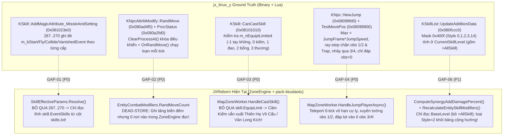

# Báo Cáo Kiểm Toán & Dự Báo Khoảng Cách Parity (Subagent 05): Tứ Đại Môn Phái Hệ Hỏa – Thổ (`Cái Bang`, `Thiên Nhẫn`, `Võ Đang`, `Côn Lôn`) & Cơ Chế Kỹ Năng Toàn Cục (`Synergy`, `SkillExp`, `Khinh Công`)

> **Phạm vi kiểm toán**:
> 1. **Hệ Hỏa — Cái Bang (`gaibang`, Faction 6)**: Chưởng pháp, Bổng pháp, Hỗ trợ/Bị động, Tuyệt kỹ 9x/120/150 & Nhiệm vụ môn phái (`UTask_gb`).
> 2. **Hệ Hỏa — Thiên Nhẫn (`tianren`, Faction 7)**: Ngoại công Mâu, Nội công Hỏa, Bùa chú Ma giáo, Tuyệt kỹ 9x/120 (`Ma Âm Phệ Phách` `randmove`)/150 & Nhiệm vụ môn phái (`UTask_tr`).
> 3. **Hệ Thổ — Võ Đang (`wudang`, Faction 8)**: Khí công, Kiếm pháp, Cơ chế khiên nội lực `Tọa Vọng Vô Ngã` (`manashield_p`), `Lưỡng Nghi Tâm Pháp` / `Thái Cực Thần Công`, Tuyệt kỹ 9x/120 (`Xuất Ứ Bất Nhiễm`)/150 & Nhiệm vụ môn phái (`UTask_wd`).
> 4. **Hệ Thổ — Côn Lôn (`kunlun`, Faction 9)**: Đao phong, Kiếm lôi, Hệ thống Bùa chú Tốc độ & Khống chế (`Thanh Phong Phù`, `Kỷ Bán Phù`, `Túy Tiên Tá Cốt`), Tuyệt kỹ 9x/120 (`Lưỡng Nghi Chân Khí`)/150 & Nhiệm vụ môn phái (`UTask_kl`).
> 5. **Cơ chế Toàn cục**: Cộng hưởng kỹ năng cấp thấp (`addskilldamage1..6`), Độ thông thạo luyện kỹ năng 9x/120 (`SkillExp`), và Khinh công (`Skill 210` — `c2s_npcjump`).
>
> **Nguồn Ground Truth đối chiếu**:
> - Binary & Decompilation (`jx_linux_y`): [legacy-server/discovery/](file:///d:/Projects/jx-reborn/legacy-server/discovery/)
> - Dữ liệu gốc & Lua: [skills.txt](file:///d:/Projects/jx-reborn/legacy-server/bin/server1/settings/skills.txt), [missles.txt](file:///d:/Projects/jx-reborn/legacy-server/bin/server1/settings/missles.txt), [gaibang.lua](file:///d:/Projects/jx-reborn/legacy-server/bin/server1/script/skill/gaibang.lua), [tianren.lua](file:///d:/Projects/jx-reborn/legacy-server/bin/server1/script/skill/tianren.lua), [wudang.lua](file:///d:/Projects/jx-reborn/legacy-server/bin/server1/script/skill/wudang.lua), [kunlun.lua](file:///d:/Projects/jx-reborn/legacy-server/bin/server1/script/skill/kunlun.lua), [skilllvlup.lua](file:///d:/Projects/jx-reborn/legacy-server/bin/server1/script/skill/skilllvlup.lua), [轻功.lua](file:///d:/Projects/jx-reborn/legacy-server/bin/server1/script/skill/special/%C7%E1%B9%A6.lua)
> - Content Pack & Server hiện tại: [base-and-factions.skills.json](file:///d:/Projects/jx-reborn/pack-tieudaotu/data/skills/base-and-factions.skills.json), [missiles.skills.json](file:///d:/Projects/jx-reborn/pack-tieudaotu/data/skills/missiles.skills.json), [progression.players.json](file:///d:/Projects/jx-reborn/pack-tieudaotu/data/players/progression.players.json), [JXReborn.ZoneEngine](file:///d:/Projects/jx-reborn/server/src/JXReborn.ZoneEngine/)

---

## 1. Tổng Quan Định Lượng & Bảng Điểm Parity (Executive Scorecard)

| Hạng mục Kiểm toán | Quy mô Legacy Ground Truth | Trạng thái Data (`pack-tieudaotu`) | Trạng thái Runtime (`ZoneEngine`) | Độ phủ Parity ước tính | Mức độ Rủi ro |
| :--- | :--- | :--- | :--- | :---: | :---: |
| **1. Cái Bang (`Faction 6`)** | 12 skill nhập môn + 2 9x (`357, 359`) + 1 120 (`714`) + 2 150 (`1073, 1074`) | `100%` template & curve có mặt; **thiếu `Events` tầng 2 trên `357` (`->389`)** | Homing `MoveKind=Follow` & `ChildSkillNum` chạy đúng; **mất nổ `Long Chiến Ư Dã` (`389`) ở lv11+**; chưa chặn `EqtLimit=2` (Bổng) | **78%** | **P0** |
| **2. Thiên Nhẫn (`Faction 7`)** | 14 skill nhập môn + 3 9x (`361, 362, 391`) + 1 120 (`715`) + 2 150 (`1075, 1076`) | `100%` template & curve có mặt; `362` kích `363` sớm từ lv1 thay vì lv11; thiếu `LevelUpScript` trên `391` | Tường lửa `138` & mưa thiên thạch `362->363` hoạt động; **`Ma Âm Phệ Phách` (`715->723` `randmove`) tê liệt hoàn toàn (`0%` hoảng loạn)**; chưa chặn `EqtLimit=3` & điều kiện tăng `391` | **68%** | **P0** |
| **3. Võ Đang (`Faction 8`)** | 12 skill nhập môn + 2 9x (`365, 368`) + 1 120 (`716`) + 2 150 (`1078, 1079`) | `100%` curve đúng; **`368` dính bug `onCollideSkillId=373` (lốc Côn Lôn!) thay vì `162` (`Huyền Nhất Vô Tượng`) ở lv16+** | **`Tọa Vọng Vô Ngã` (`manashield_p`) + sập khiên cạn mana chuẩn 100% bit-exact**; `716->738` giải dị trạng chạy đúng; sai tầng 2 của `368` & chưa chặn `EqtLimit=0` | **80%** | **P0** |
| **4. Côn Lôn (`Faction 9`)** | 18 skill nhập môn + 3 9x (`372, 375, 394`) + 1 120 (`717`) + 2 150 (`1080, 1081`) | `100%` curve có mặt; **thiếu `Events` tầng 2 trên `372` (`->373`) & `1080` (`->1108`)**; `375->387` nổ sớm từ lv1; thiếu `LevelUpScript` trên `394` | `Thanh Phong Phù` (`171`), `Kỷ Bán Phù` (`174`), `Lưỡng Nghi Chân Khí` (`717->721->722` `<25%` HP) hoạt động đúng; **mất lốc phụ `Khiếu Phong Tam Liên Kích` (`373`) của `372`**; sai điều kiện tăng `394` | **75%** | **P0** |
| **5. Cộng hưởng (`addskilldamage1..6`)** | `KSkillList::UpdateAdditionData` (`0x400f` style mask, tính theo `CurrentSkillLevel`) | `100%` bảng `addskilldamage1..6` xuất đầy đủ trong `effectScaling` | Tính đúng tổng `%` theo `BaseLevel` cho `Style 0/1/14`; **bỏ sót `+AllSkill` (`CurrentSkillLevel`)** và **xử lý sai `Style=2` (`Thiên Thanh Địa Trọc` `173`) thành buff mục tiêu thay vì nội tại người học** | **82%** | **P1** |
| **6. Luyện Skill `9x` & `120` (`SkillExp`)** | `60%` tỉ lệ mỗi hit, `1024` scale, mask `0xFFF8`, sách 90/120 + Đại Thành Bí Kíp + Bạch Cầu Hoàn 120 | Sách 90 (`SkillBook90`) & 120 (`SkillBook120`) đã port; **thiếu `Đại Thành Bí Kíp 90/120` & `Bạch Cầu Hoàn Kỹ Năng 120`** | Luyện skill `9x` qua đánh quái hoạt động chuẩn xác (`SkillExpGainProcessor`); **4 skill `120` (`714..717`) không có nguồn tăng `SkillExp` lên cấp `20`!** | **72%** | **P1** |
| **7. Khinh công (`Skill 210` — `c2s_npcjump`)** | `KNpc::NewJump` + `TestMovePos` + `DoJump` + `ServeJump` (đa frame parabol, ray-step vật cản) | Skill `210` có trong catalog (`Cost=50`, `Peace=true`, `HorseLimit=1`) | **Đang là dịch chuyển tức thời `0-tick` vô hạn tầm xa**, xuyên tường cao `obs=1/2`, cho đáp kẹt vào ô `obs=3/4`, không kiểm tra đã học `210` hay thể lực | **25%** | **P0** |
| **8. Nhiệm vụ Môn phái (`10x–60x, 90, 120, 150`)** | `149` file Lua `UTask_gb/tr/wd/kl` + `16` file `150skilltask` + chuỗi `lv120skill` | Đã port đầy đủ **Đệ tử Tiếp Dẫn** (`ClassicSectRecruiterCatalog`), **Chưởng môn nhập môn/xuất sư**, **Tẩy Tủy** | **Chưa port chuỗi nhiệm vụ cấp `10->60`, Trùng phản sư môn, Nhiệm vụ 90, Nhiệm vụ Quan tài 120 & Nhiệm vụ 150** | **20%** | **P2** |

---

## 2. Phát Hiện Lỗ Hổng Hệ Thống Cấp Engine & Data (Critical Cross-Sect Gaps)

### GAP-01 [P0 — Nghiêm trọng nhất]: `SkillEffectiveParams` bỏ qua thuộc tính sự kiện động `267..270` (`skill_startevent`, `skill_flyevent`, `skill_collideevent`, `skill_vanishedevent`)
- **Bằng chứng Ground Truth**:
  - Trong [KSkill_AddMagicAttribute_MissleAndSetting.cpp](file:///d:/Projects/jx-reborn/legacy-server/discovery/combat/skills/KSkill_AddMagicAttribute_MissleAndSetting.cpp#L110-L155) (`0x081023e0`), khi nạp dữ liệu từng cấp chiêu từ Lua, 4 mã thuộc tính:
    - `0x10b` (`267` = `skill_startevent`): ghi đè `m_bStartEvent = (p0 > 0)` và `m_nStartSkillId = p2`.
    - `0x10c` (`268` = `skill_flyevent`): ghi đè `m_bFlyingEvent = (p0 > 0)` và `m_nFlySkillId = p2`.
    - `0x10d` (`269` = `skill_collideevent`): ghi đè `m_bCollideEvent = (p0 > 0)` và `m_nCollideSkillId = p2`.
    - `0x10e` (`270` = `skill_vanishedevent`): ghi đè `m_bVanishedEvent = (p0 > 0)` và `m_nVanishedSkillId = p2`.
- **Thực trạng `JXReborn`**:
  - `pack-tieudaotu` đã xuất đầy đủ các thuộc tính `267..270` vào mảng `effectScaling` trong [base-and-factions.skills.json](file:///d:/Projects/jx-reborn/pack-tieudaotu/data/skills/base-and-factions.skills.json), nhưng trường tĩnh `eventSkills` chỉ phản ánh cột mặc định ban đầu của `skills.txt`.
  - [SkillEffectiveParams.cs](file:///d:/Projects/jx-reborn/server/src/JXReborn.ZoneEngine/Combat/SkillEffectiveParams.cs#L93-L236) chỉ giải mã `skill_eventskilllevel` (`12`), hoàn toàn **không giải mã `267, 268, 269, 270`**; còn [MissileSimulationTickSystem.Trajectory.cs](file:///d:/Projects/jx-reborn/server/src/JXReborn.ZoneEngine/Combat/MissileSimulationTickSystem.Trajectory.cs#L286-L295) và [MissileSimulationTickSystem.cs](file:///d:/Projects/jx-reborn/server/src/JXReborn.ZoneEngine/Combat/MissileSimulationTickSystem.cs#L610-L615) chỉ đọc `skill.EventSkills` tĩnh.
- **Hậu quả trực tiếp lên 4 phái Hỏa – Thổ**:
  1. **Cái Bang `Phi Long Tại Thiên` (`357`)**: Cột tĩnh `skills.txt` để `CollideEvent = 0` (`eventSkills = null`), trong khi [gaibang.lua](file:///d:/Projects/jx-reborn/legacy-server/bin/server1/script/skill/gaibang.lua#L368-L378) bật `skill_collideevent = (1, 0, 389)` từ **cấp `11..30`**. Hiện tại ở cấp `20`, rồng bay trúng mục tiêu **không bao giờ kích nổ tầng 2 `Long Chiến Ư Dã` (`389`)**!
  2. **Côn Lôn `Ngạo Tuyết Tiêu Phong` (`372`)**: Cột tĩnh `skills.txt` để `CollideEvent = 0` (`eventSkills = null`), trong khi [kunlun.lua](file:///d:/Projects/jx-reborn/legacy-server/bin/server1/script/skill/kunlun.lua#L366-L376) bật `skill_collideevent = (1, 0, 373)` từ **cấp `11..30`**. Hiện tại ở cấp `20`, chém lốc chính **không bao giờ sinh lốc xoáy phụ `Khiếu Phong Tam Liên Kích` (`373`)**, đồng thời làm **vô hiệu hóa hoàn toàn `+126%` cộng hưởng** từ chiêu 6x `Cuồng Phong Sậu Điện` (`176 -> 373`)!
  3. **Võ Đang `Nhân Kiếm Hợp Nhất` (`368`)**: Cột tĩnh `skills.txt` lưu nhầm `CollidSkillId = 373` (chiêu lốc xoáy của Côn Lôn!) và `StartSkillId = 371` từ cấp `1`. Trong [wudang.lua](file:///d:/Projects/jx-reborn/legacy-server/bin/server1/script/skill/wudang.lua#L371-L390), Lua ghi đè lại:
     - `skill_startevent` (`267`): tắt ở cấp `1..10`, bật `371` (`Thái Cực Kiếm Ý`) từ **cấp `11..30`**.
     - `skill_collideevent` (`269`): tắt ở cấp `1..15`, bật **`162` (`Huyền Nhất Vô Tượng`)** từ **cấp `16..30`**.
     - Do `ZoneEngine` đọc `skill.EventSkills` tĩnh, Võ Đang Kiếm hiện tại **đánh ra lốc Côn Lôn `373` ngay từ cấp `1` đến cấp `20`**, và **không bao giờ kích nổ `Huyền Nhất Vô Tượng` (`162`)**, làm mất trắng `+268%` cộng hưởng từ `Kiếm Phi Kinh Thiên` (`158 -> 162`)!
  4. **Thiên Nhẫn `Thiên Ngoại Lưu Tinh` (`362`) & Côn Lôn `Lôi Động Cửu Thiên` (`375`)**: Trong [tianren.lua](file:///d:/Projects/jx-reborn/legacy-server/bin/server1/script/skill/tianren.lua#L397-L403) và [kunlun.lua](file:///d:/Projects/jx-reborn/legacy-server/bin/server1/script/skill/kunlun.lua#L401-L407), tầng 2 (`363 Nghiệp Hỏa Phần Thành` và `387 Bình Địa Hám Lôi`) **bị khóa ở cấp `1..10` (`p0 = 0`)** và chỉ mở từ **cấp `11` trở lên**. Hiện tại `ZoneEngine` cho nổ tầng 2 ngay từ cấp `1`.
  5. **Kỹ năng 150 (`1073 Thời Thặng Lục Long`, `1079 Kiếm Thùy Tinh Hà`, `1080 Cửu Thiên Cương Phong`)**: Cùng nguyên nhân, `1073` mất tầng nổ `1072` (`Ngũ Diệu Càn Khôn`) ở lv11+, `1079` mất `1105` (`Kiếm Vũ Diệu Nguyệt`) ở lv16+, và `1080` mất `1108` (`Phong Minh Ngọc Toái`) ở lv11+.

---

### GAP-02 [P0]: Trạng thái Hoảng Loạn `randmove` (Attr `199` — `Ma Âm Phệ Phách` `715/723` & `Ma Âm Kích` `1131`) chưa cài đặt hành vi Runtime
- **Bằng chứng Ground Truth**:
  - [KNpcAttribModify_StatesAndSpeed.cpp](file:///d:/Projects/jx-reborn/legacy-server/discovery/attrib_modify/KNpcAttribModify_StatesAndSpeed.cpp#L473-L501) (`KNpcAttribModify::RandMove @ 0x080ad4f0`): Khi nhận `randmove`, `m_nRandMove` tăng lên và gọi `KNpc::ClearProcessAI()` (`m_ProcessAI = 0`). Khi hết thời gian bùa, nếu `m_nRandMove == 0` mới gọi `SetProcessAI()`.
  - [KNpc_CombatAndSkills.cpp](file:///d:/Projects/jx-reborn/legacy-server/discovery/npc/KNpc_CombatAndSkills.cpp#L415-L422) (`KNpc::ProcStatus @ 0x080a2fd0`) & [ServeMoveActions.cs](file:///d:/Projects/jx-reborn/legacy-server/discovery/CharacterActions/ServeMoveActions.cs#L95-L110) (`KNpc::OnRandMove @ 0x08099f00`): Mỗi tick `18-Hz` khi `m_nRandMove != 0` (trừ khi đang chết/hồi sinh/bị thương/văng lùi hoặc `m_AiMode == 10`), nếu `m_eDoing != do_walk && !m_bFrozenAction`, engine chọn ngẫu nhiên tọa độ `(curX - 50 + Random(100), curY - 50 + Random(100))` và ép nạn nhân đi bộ loạn xạ (`KNpc::Goto`).
  - [KNpc_AISyncAndBroadcast.cpp](file:///d:/Projects/jx-reborn/legacy-server/discovery/npc/KNpc_AISyncAndBroadcast.cpp#L350-L398) (`KNpc::ProcCommand @ 0x0809c940`): Khi `m_ProcessAI == 0`, toàn bộ lệnh của người chơi (`do_walk`, `do_run`, `do_jump`, `do_sit`, `do_skill`) bị chặn hoàn toàn; riêng `do_skill` trả gói `SyncSkillFailed` để client không kẹt animation!
- **Thực trạng `JXReborn`**:
  - [EntityCombatModifiers.cs](file:///d:/Projects/jx-reborn/server/src/JXReborn.ZoneEngine/Combat/EntityCombatModifiers.cs#L430-L433) có cộng dồn `RandMoveCount` khi gặp `case 199` (`"randmove"`), **nhưng toàn bộ `server/src/` không có bất kỳ dòng nào đọc `RandMoveCount`**!
  - Hệ quả: Tuyệt kỹ trấn phái cấp 120 của Thiên Nhẫn **`Ma Âm Phệ Phách` (`715 -> 723`)** (kéo dài `18 -> 72` frames = `1s -> 4s`, tối đa `6` mục tiêu trong bán kính `224 mps`, cộng thêm kích hoạt khi chết `autodeathskill`) và chiêu 150 Chiến Nhẫn `Giang Hải Nộ Lan -> Ma Âm Kích` (`1075 -> 1131`) **hoàn toàn vô tác dụng**: đối phương vẫn đứng yên, tự do chạy theo ý muốn và xả chiêu bình thường!
  - Đồng thời, 2 cờ khống chế tương tự trong [EntityCombatModifiers.cs](file:///d:/Projects/jx-reborn/server/src/JXReborn.ZoneEngine/Combat/EntityCombatModifiers.cs#L486-L493) là `ForbidAttackCount` (Attr `250`) và `FrozenActionCount` (Attr `251`) cũng đang là dead-store chưa được kiểm tra trong `HandleCastSkill` / `HandleMovePlayer`.

---

### GAP-03 [P0]: Chưa kiểm tra giới hạn vũ khí `EquipLimit` (`m_nEquiptLimited`) khi xuất chiêu
- **Bằng chứng Ground Truth**:
  - [KSkill_CanCastSkill.cpp](file:///d:/Projects/jx-reborn/legacy-server/discovery/data_loaders/KSkill_CanCastSkill.cpp#L80-L107) (`KSkill::CanCastSkill @ 0x08101010`): Kiểm tra chặt chẽ `m_nEquiptLimited`:
    - `-2`: Không giới hạn vũ khí (Chưởng Cái Bang `122/128/357`, Hỏa nội công Thiên Nhẫn `145/138/148/362`, Khí công Võ Đang `153/164/165/365`, Lôi pháp Côn Lôn `179/182/375` — lưu ý riêng `172 Thiên Tế Tấn Lôi` yêu cầu `EqtLimit = 0` Kiếm!).
    - `0`: Bắt buộc cầm **Kiếm** (`detail=0, particular=0` — Võ Đang `155, 158, 267, 368`; Côn Lôn `172`).
    - `1`: Bắt buộc cầm **Đao** (`detail=0, particular=1` — Côn Lôn `169, 176, 372, 1080`).
    - `2`: Bắt buộc cầm **Bổng/Côn** (`detail=0, particular=2` — Cái Bang `119, 125, 359, 1074`).
    - `3`: Bắt buộc cầm **Thương/Mâu** (`detail=0, particular=3` — Thiên Nhẫn `135, 141, 142, 361, 1075`).
- **Thực trạng `JXReborn`**:
  - [MapZoneWorker.Combat.cs](file:///d:/Projects/jx-reborn/server/src/JXReborn.ZoneEngine/WorldZones/MapZoneWorker.Combat.cs#L44-L315) kiểm tra `HorseLimit`, `PeaceCanUse`/`FightMode`, hồi chiêu, tầm xa, và tiêu hao Nội/Thể/Sinh lực, nhưng **không kiểm tra `skill.EquipLimit` đối chiếu với `player.WeaponType` / `player.WeaponParticular`**.
  - Hệ quả: Nhân vật tay không hoặc cầm Kiếm vẫn thi triển được `Thiên Hạ Vô Cẩu` (`Eqt=2`), `Vân Long Kích` (`Eqt=3`), `Ngạo Tuyết Tiêu Phong` (`Eqt=1`), hoặc cầm Đao xuất `Nhân Kiếm Hợp Nhất` (`Eqt=0`).
  - *Lưu ý bổ sung về Bị động vũ khí*: Trong `jx_linux_y`, các bị động `Style=3` (`115, 132, 151, 167`) luôn được cast vĩnh viễn lên nhân vật khi học ([KSkill_CastPassivitySkill.cpp](file:///d:/Projects/jx-reborn/legacy-server/discovery/combat/skills/KSkill_CastPassivitySkill.cpp#L14-L50)), còn việc lọc loại vũ khí cho `%` vật lý dựa vào `p2 = particular` của `addphysicsdamage_p` (đã được `EntityCombatModifiers` xử lý đúng qua `AddPhysicsDamageByWeaponParticularPercent`). Riêng `Cái Bang 120 Hỗn Thiên Khí Công` (`714`) có cột `EqtLimit = 1` trong `skills.txt` nhưng vì `Style = 3` (`KSkill::Cast` gọi trực tiếp `CastPassivitySkill`, không qua `CanCastSkill`), trong Legacy mọi đệ tử Cái Bang (cả Chưởng lẫn Bổng, cầm bất kỳ vũ khí nào) đều kích hoạt được `autoattackskill` `720` — `ZoneEngine` hiện khớp đúng hành vi này, **tuyệt đối không được thêm check `EquipLimit` vào `Style=3` bị động kẻo làm hỏng `714`!** Chỉ kiểm tra `EquipLimit` trong đường `CanCastSkill` (`HandleCastSkill`).

---

### GAP-04 [P0]: Khinh công (`Skill 210` — `c2s_npcjump`) đang dịch chuyển tức thời vô hạn cự ly & ngược quy tắc vật cản
- **Bằng chứng Ground Truth**:
  - [KNpc_MovementAndWorld.cpp](file:///d:/Projects/jx-reborn/legacy-server/discovery/npc/KNpc_MovementAndWorld.cpp#L104-L226) (`KNpc::TestMovePos @ 0x08099900` & `KNpc::NewJump @ 0x08099fd0`) + [JumpActions.cs](file:///d:/Projects/jx-reborn/legacy-server/discovery/CharacterActions/JumpActions.cs#L32-L110) (`DoJump @ 0x08096d80`, `ServeJump @ 0x0809a230`, `OnJump @ 0x0809b160`):
    1. **Cự ly tối đa**: `maxLen = m_CurrentJumpFrame * m_CurrentJumpSpeed`. Khởi tạo trong `KNpc` là `JumpSpeed = 12`, `JumpFrame = 40` (`480 mps`), hoặc nạp từ [basevalue.ini](file:///d:/Projects/jx-reborn/legacy-server/bin/server1/settings/npc/player/basevalue.ini) (`JumpSpeed = 20`, `JumpFrame = 16` -> `320 mps`).
    2. **Ray-step kiểm tra Trap & Vật cản theo từng bước `JumpSpeed`**:
       - Gặp **Trap** (`GetTrap != NULL`): dừng ngay tại bước đó để không nhảy xuyên qua bẫy chuyển map/chiến trường!
       - Gặp vật cản **`1` hoặc `2`** (núi/tường cao không thể nhảy qua): **dừng lại ở ô trống cuối cùng phía trước tường** (`goto switchD_08099ac8_caseD_1`).
       - Gặp vật cản **`3` hoặc `4`** (hàng rào thấp/mặt nước cho phép nhảy qua khi `bCanJumpOver == 1`): vòng lặp vẫn bước tiếp qua ô `3/4`, **NHƯNG biến `local_34` (bước đáp hợp lệ cuối cùng) CHỈ cập nhật khi `BVar2 == 0` (ô đất trống)!** Nghĩa là: **nhảy VƯỢT QUA được dải `obs = 3/4` sang ô `obs = 0` bên kia, nhưng KHÔNG BAO GIỜ ĐƯỢC ĐÁP ĐỨNG LÊN Ô `obs = 3/4`!**
    3. **Ngưỡng nhảy tối thiểu**: Nếu quãng đường hợp lệ `nLength < 0x15` (`21 mps`), `NewJump` trả `0` (chuyển thành chạy bộ `RunTo`).
    4. **Quỹ đạo đa frame (`18-Hz`)**: Đặt `m_eDoing = do_jump` trong `m_JumpStep = nLength / m_CurrentJumpSpeed` frames, phát `NPC_JUMP_SYNC (0x54)`, cập nhật độ cao parabol `Height = max(0, (f * (JumpStep*5 - 5) - 5*f*f) >> 3)` mỗi frame qua `ServeJump` (trong lúc đang bay trên không `m_ProcessAI == 0`), đến hết frame mới về `do_stand`.
    5. **Ràng buộc Ngựa & Chiêu 210**: Skill `210` (`Khinh công`) trong [skills.txt](file:///d:/Projects/jx-reborn/legacy-server/bin/server1/settings/skills.txt) có `HorseLimit = 1` (đang cưỡi ngựa không thể nhảy khinh công), `PeaceCanUse = 1`, `SkillCostType = 1` (`attrib_stamina` trong bảng enum skill hay `life` — lưu ý trong [轻功.lua](file:///d:/Projects/jx-reborn/legacy-server/bin/server1/script/skill/special/%C7%E1%B9%A6.lua) `skill_cost_v = 50`).
- **Thực trạng `JXReborn`**:
  - [MapZoneWorker.Movement.cs](file:///d:/Projects/jx-reborn/server/src/JXReborn.ZoneEngine/WorldZones/MapZoneWorker.Movement.cs#L93-L149) (`HandleJumpPlayerAsync`):
    - **Không giới hạn khoảng cách tối đa**: Client gửi `c2s_npcjump` cách `50,000 mps` sẽ dịch chuyển xuyên cả bản đồ trong `0` tick!
    - **Không ray-step các ô trung gian**: Nhảy xuyên thẳng qua tường đá đặc `obs = 1, 2` và nhảy bỏ qua toàn bộ `Trap` dọc đường!
    - **Ngược hoàn toàn logic ô đáp (`IsJumpDestinationBlocked`)**: Dòng `148` viết `obs is not (0 or 3 or 4)`, tức là **cho phép người chơi nhảy đáp thẳng vào giữa tường thấp/mặt nước `obs = 3, 4`** (khiến nhân vật bị kẹt cứng không đi bộ ra được!).
    - **Không kiểm tra cưỡi ngựa / trạng thái khống chế (`Stun`, `Freeze`, `RandMove`, `NoMove`) / kỹ năng `210`**, và đặt `Doing = Stand` tức thì ngay trong cùng 1 frame.

---

### GAP-05 [P1]: Bỏ qua `LevelUpScript` kiểm tra điều kiện nâng điểm kỹ năng Bùa 9x (`Nhiếp Hồn Loạn Tâm` `391` & `Túy Tiên Tá Cốt` `394`)
- **Bằng chứng Ground Truth**:
  - Khác với 23 bí kíp 9x luyện độ thông thạo (`IsExpSkill = 1`), 2 bí kíp bùa 9x của Thiên Nhẫn (**`391 Nhiếp Hồn Loạn Tâm`**) và Côn Lôn (**`394 Túy Tiên Tá Cốt`**) có `IsExpSkill = 0`, học từ sách ở cấp `0` và nâng bằng **Điểm Kỹ Năng** (`c2s_playerskilllevel`).
  - Trong [skills.txt](file:///d:/Projects/jx-reborn/legacy-server/bin/server1/settings/skills.txt) và [skilllvlup.lua](file:///d:/Projects/jx-reborn/legacy-server/bin/server1/script/skill/skilllvlup.lua#L112-L162):
    - `SOSkillLevelUp.Shehun_luanxin` (`391`): Muốn nâng từ cấp `mlvl` lên `mlvl + 1` (với `mlvl <= 15`), bắt buộc:
      1. Cấp nhân vật `plvl >= 80 + mlvl` (tức `mlvl == 0 -> lv80`, `mlvl == 19 -> lv99`).
      2. **Cả 5 bùa cấp thấp của Thiên Nhẫn `{136 Hỏa Liên Phần Hoa, 137 Ảo Ảnh Phi Hồ, 140 Phi Hồng Vô Tích, 364 Bi Tô Thanh Phong, 143 Lịch Ma Đoạt Hồn}` đều phải có cấp cơ bản `>= max(5, mlvl + 5)`**! (Ví dụ: để nâng điểm đầu tiên lên cấp `1`, cả 5 bùa phải `>= 5`; để nâng từ `15` lên `16..20`, cả 5 bùa phải đạt tối đa `20`!).
    - `SOSkillLevelUp.Zuixian_cuogu` (`394`): Cùng công thức chính xác cho **5 bùa cấp thấp của Côn Lôn `{392 Thúc Phược Chú, 174 Kỷ Bán Phù, 393 Bắc Minh Đáo Hải, 175 Khi Hàn Ngạo Tuyết, 90 Mê Tung Ảo Ảnh}`**!
- **Thực trạng `JXReborn`**:
  - [FactionProgressionManager.cs](file:///d:/Projects/jx-reborn/server/src/JXReborn.ZoneEngine/Factions/FactionProgressionManager.cs#L177-L236) (`TryAllocateSkillPoint`) chỉ kiểm tra `player.Level >= tpl.ReqLevel` và `slot.BaseLevel < Math.Min(tpl.MaxLevel, player.Level - tpl.ReqLevel + 1)`.
  - Hệ quả: Thiên Nhẫn / Côn Lôn vừa cắn sách ở cấp 99 có thể cộng thẳng `20` điểm vào `Nhiếp Hồn Loạn Tâm` / `Túy Tiên Tá Cốt` dù 5 bùa tiền đề đang ở cấp `0`!

---

### GAP-06 [P1]: Sai lệch `+AllSkill` (`CurrentSkillLevel`) trong Cộng hưởng & Bị động + Phân loại sai `Style = 2` (`Thiên Thanh Địa Trọc` `173`)
- **Bằng chứng Ground Truth**:
  1. Trong [KSkillList_Management.cpp](file:///d:/Projects/jx-reborn/legacy-server/discovery/combat/skills/KSkillList_Management.cpp#L454-L645) (`UpdateAdditionData @ 0x080fccc0` và `IncreaseCurrentLevel @ 0x080fd440`):
     - Khi trang bị có dòng `+Kỹ năng vốn có` (`allskill_v` -> `AddTemporary(0, nLvl)`), `CurrentSkillLevel` của mọi kỹ năng đã học (`SkillLevel > 0`) tăng thêm `nLvl`.
     - Engine gọi lại `KSkill::Cast` cho mọi bị động `Style == 3` ở **`CurrentSkillLevel` mới** (đó là lý do bảng giá trị trong `gaibang.lua`, `wudang.lua`, `kunlun.lua` được viết tới cấp `30–40`, với bước nhảy đột biến từ cấp `16+` và `30+`, ví dụ `Giáng Long Chưởng` `274` tăng hỏa sát nội công `+100` mỗi cấp sau cấp `15`: lv20 = `750`, lv23 = `1050`!).
     - Engine gọi `UpdateAdditionData(i, ulOldLevel, CurrentSkillLevel)` để tính lại `addskilldamage1..6` theo **`CurrentSkillLevel` mới**!
  2. Trong [KSkill_AddMagicAttribute_MissleAndSetting.cpp](file:///d:/Projects/jx-reborn/legacy-server/discovery/combat/skills/KSkill_AddMagicAttribute_MissleAndSetting.cpp#L126-L131) và `UpdateAdditionData`:
     - Thuộc tính `260..265` (`addskilldamage1..6`) nằm trong `m_cAdditionData` cho toàn bộ mask `(1 << style) & 0x400f` (gồm `Style 0, 1, 2, 3, 14`), **không nằm trong `m_StateAttribs`**.
     - Do đó, chiêu `173 Thiên Thanh Địa Trọc` của Côn Lôn (`Style = 2`, buff kháng cho bản thân và đồng đội) cộng vĩnh viễn `+60%` (ở lv20) sát thương cho chiêu 150 Côn Lôn (`1081`, `1109`) của **chính người học** ngay khi nâng điểm, chứ không truyền `%` cộng hưởng đó sang đồng đội được buff!
- **Thực trạng `JXReborn`**:
  - [SkillStateEffectApplier.cs](file:///d:/Projects/jx-reborn/server/src/JXReborn.ZoneEngine/Combat/SkillStateEffectApplier.cs#L195) gọi `ExtractSkillStateAttributes(skillTpl, kvp.Value.BaseLevel, ...)` và [CombatDamageCalculator.cs](file:///d:/Projects/jx-reborn/server/src/JXReborn.ZoneEngine/Combat/CombatDamageCalculator.cs#L258) gán `int level = kvp.Value.BaseLevel;` (ngoài ra `PlayerZoneState` hiện chưa cộng `EquipmentCombatModifiers.AllSkillLevelBonus` vào `EffectiveSkillLevel`).
  - [CombatDamageCalculator.cs](file:///d:/Projects/jx-reborn/server/src/JXReborn.ZoneEngine/Combat/CombatDamageCalculator.cs#L265) loại `SkillStyleKind.SelfBuff` (`Style = 2`) khỏi vòng lặp cộng hưởng, còn `SkillStateEffectApplier` lại đưa `260..265` của `Style = 2` vào `ActiveStateSkillEffect` của người nhận buff.

---

### GAP-07 [P1]: Lỗ hổng Luyện Kỹ Năng `120` (`714, 715, 716, 717`) — Không có nguồn tăng `SkillExp` trong Runtime
- **Bằng chứng Ground Truth**:
  - Cả 4 tuyệt kỹ cấp `120` của Hỏa – Thổ:
    - Cái Bang `714 Hỗn Thiên Khí Công` (`Style = 3` bị động)
    - Thiên Nhẫn `715 Ma Âm Phệ Phách` (`Style = 2` chủ động tự buff)
    - Võ Đang `716 Xuất Ứ Bất Nhiễm` (`Style = 0` giải bùa đồng đội, `IsOffensive = false`)
    - Côn Lôn `717 Lưỡng Nghi Chân Khí` (`Style = 3` bị động)
  - Trong `gaibang.lua`, `tianren.lua`, `wudang.lua`, `kunlun.lua` (`advancedskill.lua`), cả 4 kỹ năng này đều có `IsExpSkill = 1` và bảng `skill_skillexp_v` cực lớn từ cấp `1 -> 19`:
    `[17,851,239; 19,487,603; 22,760,330; ...; 620,738,181]`, **NHƯNG KHÔNG KỸ NĂNG NÀO CÓ `addskillexp1`!**
  - Trong Legacy, kỹ năng `120` không tăng thông thạo nhờ đòn đánh thường như `9x`, mà tăng thông qua:
    1. **Đại Thành Bí Kíp 120** (`6, 1, 2425` — [dachengmiji_120.lua](file:///d:/Projects/jx-reborn/legacy-server/bin/server1/script/item/dachengmiji_120.lua): nâng thẳng kỹ năng 120 đã học lên cấp `20`).
    2. **Bạch Cầu Hoàn Kỹ Năng Đặc Hiệu / Ủy thác luyện kỹ năng 120** ([skill120exp.lua](file:///d:/Projects/jx-reborn/legacy-server/bin/server1/script/skill/special/skill120exp.lua) `add120skillexpenhance_p` + hệ thống ủy thác `offline_benguyet`).
- **Thực trạng `JXReborn`**:
  - `pack-tieudaotu` đã port [SkillBook120ItemScript.cs](file:///d:/Projects/jx-reborn/pack-tieudaotu/src/JXReborn.Packs.TieuDaoTu/Scripts/Items/SkillBook120ItemScript.cs) (cấp 1), nhưng **chưa port `Đại Thành Bí Kíp 90` (`2424`), `Đại Thành Bí Kíp 120` (`2425`), cũng như cơ chế cộng exp cho kỹ năng 120**. Người chơi học xong skill 120 hiện bị kẹt vĩnh viễn ở cấp `1/20`!

---

## 3. Khảo Sát Chi Tiết Hệ Hỏa — Cái Bang (`gaibang`, Faction 6)

### 3.1. Bảng Đối Chiếu Toàn Bộ Kỹ Năng Cái Bang (`gaibang.lua` vs `pack-tieudaotu` & `ZoneEngine`)

| ID | Tên kỹ năng | Nhánh / Cấp | Style / Form / Missile | Thông số Ground Truth cốt lõi (`lv1 -> lv20` [lv30]) | Cộng hưởng (`addskilldamage`) | Trạng thái Parity |
| :---: | :--- | :---: | :--- | :--- | :--- | :---: |
| `122` | **Kiến Nhân Thân Thủ** | Chưởng `1x` | `Style=0`, `Form=line(1)`, `M46`, `Horse=1` | Hỏa sát `[15..15] -> [75..215]`; `seriesdamage_p: 1->10%`; Tầm `320->384` | `+50%` vào `357`; `+35%` vào `128`; `+40%` vào `1073/1101` | **PASS (100%)** |
| `119` | **Diên Môn Thác Bát** | Bổng `1x` | `Style=0`, `Form=line(1)`, `M45`, `Eqt=2` | Vật lý `+10->+55%`; Hỏa sát `[10..10] -> [100..150]`; `Horse=0` (đánh trên ngựa!) | `+40%` vào `359`; `+35%` vào `125`; `+32%` vào `1074` | **Thiếu check `Eqt=2`** |
| `116` | **Cái Bang Chưởng Pháp** | Bị động `1x` | `Style=3` (`passive`), `Eqt=-2` | Nội công Hỏa sát `addfiremagic_v`: `+25 -> +275` [`+406`] | — | **PASS (bỏ `+AllSkill`)** |
| `115` | **Cái Bang Bổng Pháp** | Bị động `1x` | `Style=3` (`passive`), `Eqt=2` | Vật lý Bổng (`p2=2`): `+10% -> +150%` [`+223%`]; Chí mạng `+2% -> +25%` [`+37%`] | — | **PASS (bỏ `+AllSkill`)** |
| `129` | **Hóa Hiểm Vi Di** | Bị động `2x` | `Style=3` (`passive`) | Phản đòn cận chiến `meleedamagereturn_p`: `4% -> 46%`; Né tránh `+48 -> +800` | — | **PASS (100%)** |
| `274` | **Giáng Long Chưởng** | Bị động `3x` | `Style=3` (`passive`) | **Trừ Sinh lực tối đa** `lifemax_p: -1% -> -25%` [`-38%`]; Cộng Nội lực `manamax_p: +12% -> +50%`; **Hỏa sát nội công `addfiremagic_v`**: lv1 `35` -> lv15 `250` -> **lv16 nhảy vọt `350` -> lv20 `750` [lv30 `1750`]**! | — | **PASS (cần `+AllSkill` để mở mốc `850..1750`)** |
| `124` | **Đả Cẩu Trận (Đả Cẩu Bổng)** | Bị động `3x` | `Style=3` (`passive`) | Vật lý Bổng (`p2=2`): `+10% -> +175%` [`+261%`] *(Lưu ý: ID `124` trong `Faction 6` là bị động cá nhân, không phải vòng hào quang `209`)* | — | **PASS (100%)** |
| `277` | **Hoạt Bất Lưu Thủ** | Hỗ trợ `4x` | `Style=0`, `Form=atTarget(6)`, `M114`, `TargetSelf=1` | Tốc độ di chuyển `fastwalkrun_p`: **`+9% -> +66%`** [`+96%`] trong `2160 -> 3240` frames (`120s -> 180s`). *(Không cộng kháng; kháng nằm ở `130`)* | — | **PASS (100%)** |
| `128` | **Kháng Long Hữu Hối** | Chưởng `5x` | `Style=0`, `Form=spread(2)`, `M48`, `Horse=1` | Hỏa sát `[10..10] -> [536..536]`; **`ChildSkillNum`**: lv1–10 = `1` tia (`Param1=0`), lv11–20 tăng `2, 3, 5, 6, 8, 9, 10, 12, 13, 15` tia (`Param1=2`, [lv25+ = `18` tia])! | `+55%` vào `357`; `+45%` vào `1073/1101` | **PASS (100%)** |
| `125` | **Bổng Đả Ác Cẩu** | Bổng `5x` | `Style=0`, `Form=circle(3)`, `M47`, `ChildCnt=16`, `Eqt=2` | 16 tia tỏa tròn `360°`; Vật lý `+10% -> +179%`; Hỏa sát `[70..70] -> [360..420]` | `+60%` vào `359`; `+50%` vào `1074` | **Thiếu check `Eqt=2`** |
| `130` | **Túy Điệp Cuồng Vũ** | Tự buff `6x` | `Style=2` (`selfBuff`), `Max=30` | Kháng tất cả `allres_p: +1% -> +20%` [lv30 `+30%`]; Nội hỏa `+10 -> +144` [`+215`]; Ngoại hỏa `+10 -> +118` [`+175`]; Chí mạng `+5% -> +30%` [`+43%`] (`2160 -> 3240f`) | — | **PASS (100%)** |
| `360` | **Tiêu Diêu Công** | Bị động `6x` | `Style=3` (`passive`) | **Tốc đánh ngoại công `attackspeed_v` VÀ Tốc xuất chiêu nội công `castspeed_v`**: `+6 -> +65` [lv25 `+90`, lv30 `+105`] | — | **PASS (100%)** |
| `357` | **Phi Long Tại Thiên** | Chưởng `9x` | `Style=0`, `Form=wall(0)`, `M166` (`Follow` đuổi mục tiêu!), `P2=0x10001` | **`ChildSkillNum`**: lv1–11 = `1` rồng, lv12–15 = `2` rồng, lv16–19 = `3` rồng, **lv20–30 = `4` rồng**! Hỏa sát `[10..10] -> [750..750]`. **Tầng 2 (`lv11+`)**: Va chạm kích nổ **`389 Long Chiến Ư Dã`** (`M195`, Hỏa sát `[17..17]->[371..371]`) | Nhận `+50%` (`122`) + `+55%` (`128`) = **`+105%`**; truyền `+25%` vào `1073/1101` | **FAIL (GAP-01: mất nổ `389` ở lv11+)** |
| `359` | **Thiên Hạ Vô Cẩu** | Bổng `9x` | `Style=0`, `Form=wall(0)`, `M168` (`Follow` đuổi mục tiêu!), `Eqt=2` | **`ChildSkillNum`**: lv1–10 = `1` tia, lv11–19 = `2` tia, **lv20–30 = `3` tia**! Vật lý `+12% -> +206%`; Hỏa sát `[70..70] -> [285..432]` | Nhận `+40%` (`119`) + `+60%` (`125`) = **`+100%`**; truyền `+25%` vào `1074` | **Thiếu check `Eqt=2` (quỹ đạo & số tia PASS)** |
| `714` | **Hỗn Thiên Khí Công** | Tuyệt kỹ `120` | `Style=3` (`passive`) -> `autoattackskill` `720` | Khi tấn công có tỉ lệ (`16%` lv1 -> `22%` lv20, CD `216f` = `12s` mỗi mục tiêu) phóng **`720 Quyết Chú`**: trừ Trần Kháng Vật lý `-1% -> -4%`, trừ Trần Kháng Hỏa `-1% -> -6%`, trừ Kháng Vật lý `-2% -> -10%`, trừ Kháng Hỏa `-3% -> -15%`, trừ Phản đòn tầm xa `-4% -> -30%` trong `54 -> 162f` | — | **Combat proc PASS; thiếu nguồn luyện `SkillExp` (GAP-07)** |

---

## 4. Khảo Sát Chi Tiết Hệ Hỏa — Thiên Nhẫn (`tianren`, Faction 7)

### 4.1. Bảng Đối Chiếu Toàn Bộ Kỹ Năng Thiên Nhẫn (`tianren.lua` vs `pack-tieudaotu` & `ZoneEngine`)

| ID | Tên kỹ năng | Nhánh / Cấp | Style / Form / Missile | Thông số Ground Truth cốt lõi (`lv1 -> lv20` [lv30]) | Cộng hưởng / Ràng buộc | Trạng thái Parity |
| :---: | :--- | :---: | :--- | :--- | :--- | :---: |
| `135` | **Tàn Dương Như Huyết** | Mâu `1x` | `Style=0`, `Form=line(1)`, `M54`, `Eqt=3`, `Horse=0` | Vật lý `+5% -> +55%`; Hỏa sát `[5..5] -> [50..50]`; đánh trên ngựa | `+45%` vào `361`; `+35%` vào `142`; `+38%` vào `1075` | **Thiếu check `Eqt=3`** |
| `145` | **Đơn Chỉ Liệt Diệm** | Hỏa `1x` | `Style=0`, `Form=line(1)`, `M57` (AoE 3 ô), `Horse=1` | Hỏa sát `[30..30] -> [225..225]` | `+100%` vào `362`; `+35%` vào `148`; `+83%` vào `1076` | **PASS (100%)** |
| `132` | **Thiên Nhẫn Mâu Pháp** | Bị động `1x` | `Style=3` (`passive`), `Eqt=3` | Vật lý Thương (`p2=3`): `+15% -> +215%`; Chính xác `+35% -> +272%`; Chí mạng `+6% -> +35%` | — | **PASS (bỏ `+AllSkill`)** |
| `131` | **Thiên Nhẫn Đao Pháp** | Bị động `1x` | `Style=3` (`passive`), `Eqt=-2` | Nội công Hỏa sát `addfiremagic_v`: `+15 -> +215` [`+320`] | — | **PASS (bỏ `+AllSkill`)** |
| `138` | **Thôi Sơn Điền Hải** | Hỏa `3x` | `Style=0`, `Form=wall(0)`, `M55`, `ChildCnt=10`, `P1=64`, `Horse=1` | **Tường lửa 10 cột** đứng yên đốt liên tục: `M55` có `LifeFrames = 120` (`6.67s`), `DamageIntervalFrames = 12` (`0.67s`/nhịp -> tối đa 10 nhịp đốt), Hỏa sát `[5..5] -> [45..45]`/nhịp | **`+115%` vào `362` (`Thiên Ngoại Lưu Tinh`)**; `+95%` vào `1076` | **PASS (100%)** |
| `141` | **Liệt Hỏa Tình Thiên** | Mâu `3x` | `Style=0`, `Form=circle(3)`, `M56`, `ChildCnt=16`, `Eqt=3`, `Horse=0` | 16 tia lửa tỏa tròn đánh trên ngựa; Vật lý `+15% -> +75%`; Hỏa sát `[8..8] -> [150..150]` | `+55%` vào `361`; `+45%` vào `1075` | **Thiếu check `Eqt=3`** |
| `142` | **Thâu Thiên Hoán Nhật** | Mâu `6x` | `Style=0`, `Form=line(1)`, `M69`, `Melee=1`, `UseAR=1`, `Eqt=3`, `Horse=0` | Đâm cận chiến trên ngựa (`Range=78`, `Life=4`); Vật lý `+25% -> +231%`; Hỏa `[10] -> [482]`; Hút máu `1% -> 8%`; Hút nội `1% -> 6%`; Chí mạng `4% -> 55%` | `+65%` vào `361`; `+54%` vào `1075` | **Thiếu check `Eqt=3`** |
| `148` | **Ma Diệm Thất Sát** | Hỏa `6x` | `Style=0`, `Form=atTarget(6)`, `M58`, `Start=1:192`, `Horse=1` | Hỏa sát `[35..35] -> [637..637]`; Đòn chí tử `fatallystrike_p: 12% -> 50%` | **`+87%` vào `363` (`Nghiệp Hỏa Phần Thành` — lửa mặt đất của `362`!)**; `+72%` vào `1076` | **PASS (100%)** |
| `150` | **Thiên Ma Giải Thể** | Tự buff `6x` | `Style=2` (`selfBuff`), `Max=30` | Né tránh `+75 -> +582`, Chính xác `+65% -> +415%`, Nội/Ngoại Hỏa `+20 -> +213`, Hỏa cường hóa `fireenhance_p +31% -> +76%`, Tốc đánh `+26 -> +75`, Tốc xuất chiêu `+26 -> +62`, Phục hồi `+5 -> +40` (`2160 -> 4990f`) *(Bản SHXT/CTC đã bỏ trừ máu của bản Công Thành Chiến sơ kỳ)* | — | **PASS (100%)** |
| `136` | **Hỏa Liên Phần Hoa** | Bùa `1x` | `Style=0`, `Form=atTarget(6)`, `M20` | Trừ phản đòn cận chiến đối phương: `-5% -> -35%` (`720 -> 2160f`) | Tiền đề của `391` | **PASS (100%)** |
| `137` | **Ảo Ảnh Phi Hồ** | Bùa `2x` | `Style=0`, `Form=atTarget(6)`, `M20` | Trừ chính xác đối phương `attackratingenhance_p`: `-15% -> -132%` (`720 -> 2160f`) | Tiền đề của `391` | **PASS (100%)** |
| `140` | **Phi Hồng Vô Tích** | Bùa `3x` | `Style=0`, `Form=atTarget(6)`, `M20` | Trừ né tránh đối phương `adddefense_v`: `-150 -> -1100` (`720 -> 2160f`) | Tiền đề của `391` | **PASS (100%)** |
| `364` | **Bi Tô Thanh Phong** | Bùa `4x` | `Style=0`, `Form=atTarget(6)`, `M20` | Trừ thời gian phục hồi `fasthitrecover_v` (làm đối phương giật khựng liên tục): `-6 -> -30` (`720 -> 2160f`) | Tiền đề của `391` | **PASS (100%)** |
| `143` | **Lịch Ma Đoạt Hồn** | Bùa `5x` | `Style=0`, `Form=atTarget(6)`, `M20` | Trừ sát thương vật lý ngoại công đối phương (`p2=6` mọi vũ khí): `-25% -> -215%` (`720 -> 2160f`) | Tiền đề của `391` | **PASS (100%)** |
| `391` | **Nhiếp Hồn Loạn Tâm** | Bùa `9x` | `Style=0`, `Form=atTarget(6)`, `M20`, `IsExp=0` | Tổng hợp 6 debuff (`-128%` AR, `-800` Né, `-205%` Vật lý, `-30` Phục hồi, `-15` Hồi máu, `-35%` Chí mạng ở lv20) | **Bắt buộc `{136,137,140,364,143} >= max(5, mlvl+5)`** | **FAIL điều kiện nâng điểm (GAP-05)** |
| `361` | **Vân Long Kích** | Mâu `9x` | `Style=0`, `Form=line(1)`, `M169`, `Melee=1`, `UseAR=1`, `Eqt=3`, `Horse=0` | Đâm thương cận chiến trên ngựa (`Range=90`, `Life=4`, `Speed=30`); Vật lý `+45% -> +445%`; Hỏa `[6] -> [378]`; Hút máu/nội `1% -> 16%`; Chí mạng `4% -> 65%` | Nhận `+45%` (`135`) + `+55%` (`141`) + `+65%` (`142`) = **`+165%`** | **Thiếu check `Eqt=3` (sát thương & hút máu/mana PASS)** |
| `362` | **Thiên Ngoại Lưu Tinh** | Hỏa `9x` | `Style=0`, `Form=atTarget(6)`, `M171` -> `Vanished=363`, `Horse=1` | Thiên thạch `M171` rơi từ độ cao `Height=320`, `ZSpeed=-40960`, `ZAccel=1024`, `Life=14` (`[11..462]` Hỏa sát). Khi chạm đất (`lv11+`) sinh vùng lửa cháy mặt đất **`363 Nghiệp Hỏa Phần Thành`** (`M170`, `Life=54`, `DmgInt=6` = 9 nhịp đốt AoE 4 ô, Hỏa sát `[21..320]`) | `362` nhận `+100%` (`145`) + `+115%` (`138`) = **`+215%`**; `363` nhận **`+87%`** (`148`)! | **Quỹ đạo rơi & sinh lửa mặt đất PASS; sai mốc mở `363` ở lv1–10 (GAP-01)** |
| `715` | **Ma Âm Phệ Phách** | Tuyệt kỹ `120` | `Style=2` (`selfBuff`) -> `OnStart=723` + `autodeathskill=723` | Tức thời phát sóng âm `723` (`M273`, bán kính `224 mps`, tối đa `6` địch, tỉ lệ trượt `65% -> 15%`, CD `45s -> 20s`) gây **Hoảng loạn `randmove` trong `18 -> 72` frames (`1s -> 4s`)**, kèm tự nổ `100%` khi tử vong | — | **FAIL NẶNG (GAP-02: `randmove` 0% tác dụng + GAP-07)** |

---

## 5. Khảo Sát Chi Tiết Hệ Thổ — Võ Đang (`wudang`, Faction 8)

### 5.1. Giải Mã Cơ Chế Đặc Trưng Võ Đang: `Tọa Vọng Vô Ngã` (`manashield_p`) & `Lưỡng Nghi Tâm Pháp`

1. **Công thức chính xác của `Tọa Vọng Vô Ngã` (`157`) + đối trọng `Võ Đang Quyền Pháp` (`152`) khi cạn Nội lực giữa đòn đánh**:
   - **Dữ liệu Ground Truth ([wudang.lua](file:///d:/Projects/jx-reborn/legacy-server/bin/server1/script/skill/wudang.lua#L36-L46), [wudang.lua#L194-L207](file:///d:/Projects/jx-reborn/legacy-server/bin/server1/script/skill/wudang.lua#L194-L207))**:
     - `Tọa Vọng Vô Ngã` (`157`, `Style = 2 selfBuff`): `manashield_p` tăng `25%` (lv1) -> `75%` (lv5) -> **`99%` (lv20)** [`100%` ở lv21+].
     - `Võ Đang Quyền Pháp` (`152`, `Style = 3 passive`): Bên cạnh cộng Lôi sát nội công (`+20 -> +915`), bị động này **TRỪ `manashield_p` từ `-5%` (lv1) đến `-25%` (lv20)**! Do đó ở cấp 20 không đồ `+skill`, Võ Đang Khí có tổng `manashield_p = 99% - 25% = 74%`, trong khi Võ Đang Kiếm (không tăng `152`) đạt tới `99%`!
   - **Công thức Binary khi Nội lực cạn giữa đòn đánh ([combat.damage.shields_and_return_damage.json](file:///d:/Projects/jx-reborn/legacy-server/discovery/combat/damage/combat.damage.shields_and_return_damage.json#L91-L95) — `KNpc::CalcDamage @ 0x0809e790`)**:
     \[
     \text{manaAbsorb} = \left\lfloor \frac{\text{ManaShieldPercent} \times \text{dmg}}{100} \right\rfloor
     \]
     - **Trường hợp Đủ Nội lực (`CurrentMana >= manaAbsorb`)**:
       `CurrentMana -= manaAbsorb; dmg -= manaAbsorb;` (Nội lực gánh đúng phần chuyển hóa, Sinh lực chỉ nhận phần dư).
     - **Trường hợp Cạn Nội lực giữa đòn đánh (`CurrentMana < manaAbsorb`)**:
       **`CurrentMana = 0;` VÀ `dmg` KHÔNG ĐƯỢC GIẢM DÙ CHỈ 1 ĐIỂM!** Toàn bộ nội lực còn lại bị quét sạch về `0` đồng thời nhân vật hứng trọn **`100%` sát thương `dmg` thẳng vào Sinh lực** ("vỡ khiên sốc máu" kinh điển của Võ Đang!).
   - **Đối chiếu `JXReborn`**: [CombatDamageCalculator.Resolution.cs](file:///d:/Projects/jx-reborn/server/src/JXReborn.ZoneEngine/Combat/CombatDamageCalculator.Resolution.cs#L819-L831) cài đặt **khớp tuyệt đối 100% từng phép chia nguyên và nhánh vỡ khiên `CurrentMana = 0`**!

2. **Sự thật Ground Truth về `Lưỡng Nghi Tâm Pháp` (`161`) và `Thái Cực Thần Công` (`166`)**:
   - Trong bản Beta sơ kỳ ([Á½ÒÇÐÄ·¨.lua](file:///d:/Projects/jx-reborn/legacy-server/bin/server1/script/skill/wudang/%C1%BD%D2%C7%D0%C4%B7%A8.lua)), `Skill 161 Lưỡng Nghi Tâm Pháp` chỉ tăng `castspeed_v = floor(log10(level+1)*80)`.
   - Sang bản Sơn Hà Xã Tắc / Tình Trong Thiên Hạ (`server1/settings/skills.txt` dòng `161` & `progression.players.json`), Kingsoft **đã gỡ `161` và `156 Thuần Dương Tâm Pháp` khỏi cây kỹ năng Võ Đang** (`LvlData1 = ""` rỗng), và **hợp nhất cả hai vào Trấn Phái `Skill 166 Thái Cực Thần Công`**!
   - Trong [wudang.lua](file:///d:/Projects/jx-reborn/legacy-server/bin/server1/script/skill/wudang.lua#L305-L345), `Thái Cực Thần Công` (`166`) cộng đồng thời **CẢ `attackspeed_v` (`21 -> 49` ở lv20, `65` ở lv30, `90` ở lv35) LẪN `castspeed_v` (`21 -> 49` ở lv20, `65` ở lv30, `81` ở lv35)**, kèm `+manamax_p` (`35% -> 172%` [lv30 `245%`]), `manareplenish_v`, `addlightingdamage_v`, `lightingenhance_p`, `deadlystrikeenhance_p`. `pack-tieudaotu` và `ZoneEngine` đều phản ánh chính xác thiết kế này!

### 5.2. Bảng Đối Chiếu Toàn Bộ Kỹ Năng Võ Đang (`wudang.lua` vs `pack-tieudaotu` & `ZoneEngine`)

| ID | Tên kỹ năng | Nhánh / Cấp | Style / Form / Missile | Thông số Ground Truth cốt lõi (`lv1 -> lv20` [lv30]) | Cộng hưởng (`addskilldamage`) | Trạng thái Parity |
| :---: | :--- | :---: | :--- | :--- | :--- | :---: |
| `153` | **Nộ Lôi Chỉ** | Khí `1x` | `Style=0`, `Form=line(1)`, `M24`, `Horse=0` | Lôi sát `[1..1] -> [5..75]`; đánh được trên ngựa | **`+110%` vào `365`**; `+35%` vào `165`; `+92%` vào `1078` | **PASS (100%)** |
| `155` | **Thương Hải Minh Nguyệt** | Kiếm `1x` | `Style=0`, `Form=line(1)`, `M25`, `Eqt=0`, `Horse=1` | Vật lý `+5% -> +75%`; Lôi sát `[6..6] -> [12..115]` (`DmgInt=4` xuyên) | `+60%` vào `368`; `+35%` vào `267`; `+52%` vào `1079` | **Thiếu check `Eqt=0`** |
| `151` | **Võ Đang Kiếm Pháp** | Bị động `1x` | `Style=3` (`passive`), `Eqt=0` | Vật lý Kiếm (`p2=0`): `+25% -> +215%`; Chính xác `+15% -> +72%`; Chí mạng `+6% -> +25%` | — | **PASS (lưu ý `deadlystrike`/`AR` vẫn cộng khi cầm đao)** |
| `152` | **Võ Đang Quyền Pháp** | Bị động `1x` | `Style=3` (`passive`), `Eqt=-2` | Nội Lôi `addlightingmagic_v: +20 -> +915` [`+1780`]; **Trừ `manashield_p: -5% -> -25%`** | — | **PASS (100%)** |
| `159` | **Thất Tinh Trận** | Hào quang `2x` | `Style=2`, `IsAura=1`, `Child=211` (`M92` 320 mps) | Tăng Chính xác `+24% -> +450%` & Né tránh `+97 -> +800` cho bản thân + đồng đội (`18f`/nhịp) | — | **PASS (qua `CastPlayerActiveAura`)** |
| `164` | **Bác Cập Nhi Phục** | Khí `3x` | `Style=0`, `Form=atTarget(6)`, `M28` (AoE 4 ô), `Horse=1` | Lôi sát `[5..5] -> [8..175]`; **Choáng `stun_p`: tỉ lệ `20% -> 55%` trong `1 -> 20f`** | **`+120%` vào `365`**; `+100%` vào `1078` | **PASS (100%)** |
| `158` | **Kiếm Phi Kinh Thiên** | Kiếm `3x` | `Style=0`, `Form=atTarget(6)`, `M26` (AoE 3 ô), `Eqt=0`, `Horse=1` | Vật lý `+20% -> +115%`; Lôi sát `[10..10] -> [24..225]` | **`+268%` vào `162` (`Huyền Nhất Vô Tượng` — tầng 2 của `368`!)**; `+220%` vào `1107` | **Mất tác dụng trên `368` do GAP-01!** |
| `160` | **Thê Vân Tung** | Bị động `4x` | `Style=3` (`passive`) | Tốc chạy vĩnh viễn `fastwalkrun_p`: **`+18% -> +60%`** [`+82%`] | — | **PASS (100%)** |
| `157` | **Tọa Vọng Vô Ngã** | Tự buff `5x` | `Style=2` (`selfBuff`) | Chuyển hóa sát thương sang Nội lực **`manashield_p`: `25% -> 99%`** [`100%`] trong `2160 -> 3240f` | — | **PASS (100% bit-exact)** |
| `165` | **Vô Ngã Vô Kiếm** | Khí `6x` | `Style=0`, `Form=spread(2)`, `M29`, `Horse=1` | Toả kiếm khí hình quạt: `ChildSkillNum` tăng từ `1` (lv1–3) lên **`8` tia (lv20)**; Lôi sát `[1..5] -> [5..752]`; Choáng `5% -> 20%` (`1 -> 10f`) | **`+130%` vào `365`**; `+108%` vào `1078` | **PASS (100%)** |
| `267` | **Tam Hoàn Thao Nguyệt** | Kiếm `6x` | `Style=0`, `Form=line(1)`, `M110`, `ChildCnt=3`, `Melee=1`, `UseAR=1`, `Eqt=0` | **3 tia kiếm cận chiến liên hoàn** (`MslsGen=order:6`, `Range=78`, `Life=4`); Vật lý `+20% -> +231%`; Chính xác `+65% -> +345%`; Choáng `1% -> 10%` | **`+125%` vào `368`**; `+105%` vào `1079` | **Thiếu check `Eqt=0`** |
| `166` | **Thái Cực Thần Công** | Bị động `6x` | `Style=3` (`passive`), `Max=30` | `attackspeed_v: +21 -> +49` [`+65`], `castspeed_v: +21 -> +49` [`+65`], `manamax_p: +35% -> +172%` [`+245%`], Ngoại Lôi `+20 -> +275`, Lôi cường hóa `+16% -> +71%` | — | **PASS (100%)** |
| `365` | **Thiên Địa Vô Cực** | Khí `9x` | `Style=0`, `Form=atTarget(6)`, `M173` (AoE `128 mps` = 4 ô), `Horse=1` | Kiếm khí nổ lôi sát diện rộng tại mục tiêu: `Life=8 -> 20f`, `DmgInt=4f` (5 nhịp giật lôi sát `[5..5] -> [8..350]`), **Choáng diện rộng `stun_p: 10% -> 20%` (`1 -> 6f`)** | Nhận `+110%` (`153`) + `+120%` (`164`) + `+130%` (`165`) = **`+360%`**! | **PASS (100%)** |
| `368` | **Nhân Kiếm Hợp Nhất** | Kiếm `9x` | `Style=0`, `Form=line(1)`, `M175`, `ChildCnt=3`, `Melee=1`, `UseAR=1`, `Eqt=0`, `Horse=1` | **3 tia kiếm cận chiến** (`Range=90`, `Life=4`), Hút nội `1% -> 5%`, Chí mạng `16% -> 25%`. **Tầng phụ**: `lv11+` xuất `371 Thái Cực Kiếm Ý` (`stun_p 1->20%`); **`lv16+` va chạm nổ `162 Huyền Nhất Vô Tượng`** | `368` nhận `+60%` (`155`) + `+125%` (`267`) = **`+185%`**; `162` nhận **`+268%`** (`158`) | **FAIL (GAP-01: đang nổ nhầm sang `373` của Côn Lôn!)** |
| `716` | **Xuất Ứ Bất Nhiễm** | Tuyệt kỹ `120` | `Style=0`, `Form=atFirer(7)`, `M274` (đồng đội `320 mps`) + `OnStart=738` (bản thân) | CD `630 -> 270f` (`35s -> 15s`), tỉ lệ trượt `85% -> 15%`. Trên đồng đội gắn `ignorenegativestate_p = 1%` (`18f`); trên **bản thân (`738`) gắn `ignorenegativestate_p = 100%` trong `18 -> 54f` (`1s -> 3s`)**, lập tức **xóa sạch Đóng băng, Trúng độc, Choáng và mọi bùa âm**! | — | **Giải dị trạng PASS 100%; thiếu nguồn luyện `SkillExp` (GAP-07)** |

---

## 6. Khảo Sát Chi Tiết Hệ Thổ — Côn Lôn (`kunlun`, Faction 9)

### 6.1. Bảng Đối Chiếu Toàn Bộ Kỹ Năng Côn Lôn (`kunlun.lua` vs `pack-tieudaotu` & `ZoneEngine`)

| ID | Tên kỹ năng | Nhánh / Cấp | Style / Form / Missile | Thông số Ground Truth cốt lõi (`lv1 -> lv20` [lv30]) | Cộng hưởng / Ràng buộc | Trạng thái Parity |
| :---: | :--- | :---: | :--- | :--- | :--- | :---: |
| `169` | **Hô Phong Pháp** | Đao `1x` | `Style=0`, `Form=line(1)`, `M14` (`Follow=npc`), `Eqt=1`, `Horse=0` | Vật lý `+5% -> +75%`; Lôi sát `[15..15] -> [180..180]`; đánh trên ngựa | **`+100%` vào `372`**; `+35%` vào `176`; `+83%` vào `1080` | **Thiếu check `Eqt=1`** |
| `179` | **Cuồng Lôi Chấn Địa** | Kiếm `1x` | `Style=0`, `Form=atTarget(6)`, `M17`, `Horse=1` | Lôi sát AoE `[27..27] -> [315..315]` | **`+60%` vào `375`**; `+35%` vào `182`; `+50%` vào `1109` | **PASS (100%)** |
| `167` | **Côn Lôn Đao Pháp** | Bị động `1x` | `Style=3` (`passive`), `Eqt=1` | Vật lý Đao (`p2=1`): `+35% -> +215%`; Chí mạng `+6% -> +50%` | — | **PASS (bỏ `+AllSkill`)** |
| `168` | **Côn Lôn Kiếm Pháp** | Bị động `1x` | `Style=3` (`passive`), `Eqt=-2` | Nội Lôi `addlightingmagic_v`: `+19 -> +215` [`+318`] | — | **PASS (bỏ `+AllSkill`)** |
| `171` | **Thanh Phong Phù** | Bùa Buff `1x` | `Style=0`, `Form=atTarget(6)`, `M19` (AoE 3 ô, `canCollideFriend=true`), `TargetSelf=1, TargetAlly=1` | **Buff tốc chạy cho đồng đội & bản thân** `fastwalkrun_p`: **`+22% -> +60%`** [`+80%`] trong `2160f` (`120s`), tầm xa `440 mps` | — | **PASS (buff đồng đội hoạt động chuẩn qua `OnMissileHitPlayerRaw`)** |
| `392` | **Thúc Phược Chú** | Bùa `1x` | `Style=0`, `Form=atTarget(6)`, `M290` | Trừ phản đòn tầm xa `rangedamagereturn_p`: `-5% -> -35%` (`810 -> 2160f`) | Tiền đề của `394` | **PASS (100%)** |
| `174` | **Kỷ Bán Phù (Khiên Cơ Địa Độn)** | Bùa Chậm `2x` | `Style=0`, `Form=atTarget(6)`, `M20`, `TargetOnly=1, TargetEnemy=1` | **Bùa làm chậm tốc chạy đối phương** `fastwalkrun_p`: **`-22% -> -52%`** [`-68%`] trong `360 -> 1620f` (`20s -> 90s`)! | Tiền đề của `394` | **PASS (100%)** |
| `172` | **Thiên Tế Tấn Lôi** | Kiếm `3x` | `Style=0`, `Form=line(1)`, `M15` + `OnStart=399` (`6` tia `M197`), `Eqt=0`, `Horse=1` | Lôi sát `[25..25] -> [550..550]` | **`+65%` vào `375`**; `+54%` vào `1109` | **Thiếu check `Eqt=0`** |
| `173` | **Thiên Thanh Địa Trọc** | Buff `3x` | `Style=2` (`selfBuff`), `TargetSelf=1, TargetAlly=1` | Cộng 4 kháng (`lightingres/coldres +13%->+32%`, `fireres/physicsres +9%->+28%`) trong `2160f` | Cộng `+60%` vào `1081` & `+60%` vào `1109` | **Lệch cơ chế cộng hưởng `Style=2` (GAP-06)** |
| `177` | **Bách Xuyên Nạp Hải** | Buff `3x` | `Style=2` (`selfBuff`), `TargetSelf=1, TargetAlly=1` | Cộng Kháng Băng `+13% -> +32%` & Kháng Vật lý `+9% -> +28%` (`2160f`) | — | **PASS (100%)** |
| `178` | **Nhất Khí Tam Thanh** | Bị động `3x` | `Style=3` (`passive`), `Eqt=1` | Vật lý Đao/Kiếm + Chí mạng *(trong `skills.txt` chuyển thành `Style=3` bị động cá nhân)* | — | **PASS (100%)** |
| `393` | **Bắc Minh Đáo Hải** | Bùa `3x` | `Style=0`, `Form=atTarget(6)`, `M20` | Rút Sinh lực & Nội lực theo nhịp hồi phục (`lifereplenish_v: -1 -> -15`, `manareplenish_v: -1 -> -20` trong `810 -> 2160f`) | Tiền đề của `394` | **PASS (100%)** |
| `175` | **Khi Hàn Ngạo Tuyết** | Bùa `4x` | `Style=0`, `Form=atTarget(6)`, `M20` | **Trừ tốc xuất chiêu nội công đối phương** `castspeed_v`: **`-6 -> -39`** [`-50`] trong `810 -> 2160f` | Tiền đề của `394` | **PASS (100%)** |
| `181` | **Khí Tâm Phù** | Bùa Choáng `4x` | `Style=0`, `Form=atTarget(6)`, `M22` (AoE 3 ô) | Gây choáng diện rộng không sát thương `stun_p`: tỉ lệ `16% -> 35%` trong `5 -> 36f` (`0.28s -> 2s`) | — | **PASS (100%)** |
| `90` | **Mê Tung Ảo Ảnh** | Bùa `5x` | `Style=0`, `Form=atTarget(6)`, `M20` | Kéo dài thời gian Làm chậm & Choáng trên mục tiêu (`freezetimereduce_p` & `stuntimereduce_p`: **`-5% -> -50%`** [`-74%`] trong `810 -> 2160f`) | Tiền đề của `394` | **PASS (100%)** |
| `176` | **Cuồng Phong Sậu Điện** | Đao `5x` | `Style=0`, `Form=line(1)`, `M16` (`Life=40, DmgInt=4`), `Eqt=1`, `Horse=1` | Lốc điện xuyên suốt: Vật lý `+55% -> +386%`, Lôi sát `[45..45] -> [532..532]`, Choáng `5% -> 15%` (`1 -> 20f`) | **`+126%` vào `373` (`Khiếu Phong Tam Liên Kích` — lốc phụ của `372`!)**; `+110%` vào `1108` | **Mất tác dụng trên `372` do GAP-01!** |
| `182` | **Ngũ Lôi Chính Pháp** | Kiếm `6x` | `Style=0`, `Form=atTarget(6)`, `M18`, `ChildCnt=4`, `MslsGen=randomOrder:5`, `Horse=1` | Giáng 4 tia sét ngẫu nhiên xuống vùng mục tiêu; Lôi sát `[25..25] -> [937..937]` | **`+70%` vào `375`**; `+58%` vào `1109` | **PASS (100%)** |
| `275` | **Sương Ngạo Côn Lôn** | Bị động `6x` | `Style=3` (`passive`), `Max=30` | Trấn phái Côn Lôn: `attackspeed_v: +25 -> +65` [`+85`], `castspeed_v: +25 -> +51` [`+65`], Nội Lôi `+30 -> +216`, Ngoại Lôi `+45 -> +221`, Chí mạng `+6% -> +11%` *(Bản SHXT là `Style=3` bị động, không phải hào quang)* | — | **PASS (100%)** |
| `630` | **Huyền Thiên Vô Cực** | Bị động `1x` | `Style=3` (`passive`) | Khiên nội lực động `dynamicmagicshield_v: 50 -> 550` + Kháng phản đòn `returnres_p: 5% -> 30%` | — | **PASS (100%)** |
| `394` | **Túy Tiên Tá Cốt** | Bùa `9x` | `Style=0`, `Form=atTarget(6)`, `M20`, `IsExp=0` | Tổng hợp 5 debuff nặng: Kéo dài Băng/Choáng `-50%`, Rút máu `-15`, Rút nội `-20`, Trừ phản đòn xa `-35%` (`2160f`) *(Lưu ý: giảm tốc xuất chiêu nằm ở `175`, choáng nằm ở `181`)* | **Bắt buộc `{392,174,393,175,90} >= max(5, mlvl+5)`** | **FAIL điều kiện nâng điểm (GAP-05)** |
| `372` | **Ngạo Tuyết Tiêu Phong** | Đao `9x` | `Style=0`, `Form=line(1)`, `M178` (`DmgRng=4, DmgInt=4`), `Eqt=1`, `Horse=1` | Lốc chính: Vật lý `+5% -> +280%`, Lôi sát `[39..39] -> [673..673]`, Choáng `5% -> 25%` (`1 -> 12f`). **Tầng 2 (`lv11+`)**: Va chạm sinh lốc xoáy đứng yên **`373 Khiếu Phong Tam Liên Kích`** (`M179`, `Life=6->24f`, `DmgInt=5f`, Lôi sát `[85..115] -> [330..550]`) | `372` nhận **`+100%`** (`169`); `373` nhận **`+126%`** (`176`)! | **FAIL NẶNG (GAP-01: mất lốc phụ `373` ở lv11+!)** |
| `375` | **Lôi Động Cửu Thiên** | Kiếm `9x` | `Style=0`, `Form=atTarget(6)`, `M181` (`Life=12, DmgInt=10`), `ChildCnt=4`, `MslsGen=randomOrder:5`, `Horse=1` | **Sét giáng trễ từ trên trời xuống**: 4 tia sét lệch nhịp (`0..15f`), mỗi tia rơi trễ theo `DmgInt=10` frames (`[80..80] -> [470..470]` Lôi sát) rồi kích nổ tầng 2 **`387 Bình Địa Hám Lôi`** (`M193`, `Life=12, DmgInt=4`, Lôi sát `[25..25] -> [250..250]`, Choáng `5% -> 20%`) ở `lv11+`! | Nhận `+60%` (`179`) + `+65%` (`172`) + `+70%` (`182`) = **`+195%`**! | **Sét giáng trễ & nổ `387` PASS; sai mốc mở `387` ở lv1–10 (GAP-01)** |
| `717` | **Lưỡng Nghi Chân Khí** | Tuyệt kỹ `120` | `Style=3` (`passive`) -> `autorescueskill` `721 -> 722` | Khi Sinh lực tụt xuống **`< 25%` HP** ([CombatDamageCalculator.Resolution.cs](file:///d:/Projects/jx-reborn/server/src/JXReborn.ZoneEngine/Combat/CombatDamageCalculator.Resolution.cs#L951-L954)), tự kích `100%` (CD `1620 -> 900f` = `90s -> 50s`): **`721 Ma Pháp Độn`** tạo khiên hấp thụ sát thương tĩnh `staticmagicshield_p = 1800 -> 10,000` điểm + **`722 Gia Tốc`** tăng tốc chạy `+5% -> +35%` trong `90 -> 180f` (`5s -> 10s`)! | — | **Auto-rescue `<25%` HP PASS 100%; thiếu nguồn luyện `SkillExp` (GAP-07)** |

---

## 7. Kiểm Toán Cơ Chế Toàn Cục (`Synergy`, `SkillExp`, `Khinh Công` & Nhiệm Vụ Môn Phái)

### 7.1. Ma trận Cộng hưởng Sát thương Kỹ năng `9x` (`addskilldamage1..6` tại Cấp Cơ Bản `20`)

| Phái | Kỹ năng `9x` nhận cộng hưởng | Nguồn `1x` (lv20) | Nguồn `3x / 5x` (lv20) | Nguồn `6x` (lv20) | Tổng `%` Cộng hưởng ở lv20 | Đánh giá Runtime hiện tại |
| :--- | :--- | :--- | :--- | :--- | :---: | :--- |
| **Cái Bang** | `357 Phi Long Tại Thiên` | `122 Kiến Nhân` (`+50%`) | `128 Kháng Long` (`+55%`) | — | **`+105%`** | Tính đúng `+105%` trên `357`, nhưng mất tầng 2 `389` (GAP-01) |
| **Cái Bang** | `359 Thiên Hạ Vô Cẩu` | `119 Diên Môn` (`+40%`) | `125 Bổng Đả Ác Cẩu` (`+60%`) | — | **`+100%`** | **PASS (`+100%`)** (chỉ thiếu cộng thêm từ `+AllSkill`) |
| **Thiên Nhẫn** | `361 Vân Long Kích` | `135 Tàn Dương` (`+45%`) | `141 Liệt Hỏa` (`+55%`) | `142 Thâu Thiên` (`+65%`) | **`+165%`** | **PASS (`+165%`)** |
| **Thiên Nhẫn** | `362 Thiên Ngoại Lưu Tinh` (+ `363`) | `145 Đơn Chỉ` (`+100%` vào `362`) | `138 Thôi Sơn` (`+115%` vào `362`) | `148 Ma Diệm` (`+87%` vào **`363`**) | **`+215%` (`362`) / `+87%` (`363`)** | **PASS** (nhờ `childPayloadFactory` tính riêng `ComputeSynergyAddDamagePercent` cho `363`!) |
| **Võ Đang** | `365 Thiên Địa Vô Cực` | `153 Nộ Lôi Chỉ` (`+110%`) | `164 Bác Cập` (`+120%`) | `165 Vô Ngã` (`+130%`) | **`+360%`** | **PASS (`+360%`)** |
| **Võ Đang** | `368 Nhân Kiếm Hợp Nhất` (+ `162`) | `155 Thương Hải` (`+60%` vào `368`) | `158 Kiếm Phi` (`+268%` vào **`162`**) | `267 Tam Hoàn` (`+125%` vào `368`) | **`+185%` (`368`) / `+268%` (`162`)** | **`368` đúng `+185%`, nhưng `162` mất trắng `+268%`** do `368` nổ nhầm sang `373`! |
| **Côn Lôn** | `372 Ngạo Tuyết Tiêu Phong` (+ `373`) | `169 Hô Phong` (`+100%` vào `372`) | `176 Cuồng Phong` (`+126%` vào **`373`**) | — | **`+100%` (`372`) / `+126%` (`373`)** | **`372` đúng `+100%`, nhưng `373` mất trắng `+126%`** do `372` không sinh `373`! |
| **Côn Lôn** | `375 Lôi Động Cửu Thiên` | `179 Cuồng Lôi` (`+60%`) | `172 Thiên Tế` (`+65%`) | `182 Ngũ Lôi` (`+70%`) | **`+195%`** | **PASS (`+195%`)** |

### 7.2. Độ Thông Thạo Kỹ Năng `9x` & `120` (`SkillExp`)
- **Kỹ năng `9x` (`357, 359, 361, 362, 365, 368, 372, 375`)**:
  - [SkillExpGainProcessor.cs](file:///d:/Projects/jx-reborn/server/src/JXReborn.ZoneEngine/Combat/SkillExpGainProcessor.cs) cài đặt **khớp 100%** với [KSkillList_AddSkillExp_AccumulateAndLevelUp.cpp](file:///d:/Projects/jx-reborn/legacy-server/discovery/combat/skills/KSkillList_AddSkillExp_AccumulateAndLevelUp.cpp) (`0x080fd200`):
    - Xác suất `60%` mỗi mục tiêu trúng đòn (`addskillexp1` với `p0 = 0` tự ánh xạ về chính ID chiêu đó, cộng `+1` điểm/hit nhân hệ số `SkillExpEnhancePercent`).
    - Đạt ngưỡng `skill_skillexp_v[BaseLevel]` (ví dụ lv1->lv2: `Phi Long 357 = 2,150`, `Thiên Hạ Vô Cẩu 359 = 1,750`, `Vân Long Kích 361 = 2,900`, `Thiên Ngoại Lưu Tinh 362 = 3,063`, `Thiên Địa Vô Cực 365 = 7,350`, `Nhân Kiếm 368 = 5,400`, `Ngạo Tuyết 372 = 8,575`, `Lôi Động 375 = 10,660`) sẽ tự tăng `BaseLevel + 1`, xóa `SkillExp = 0`, cập nhật gói `0x5E` theo bước ngưỡng bitmask `0xFFF8` (`8/1024`), và dừng ở `MaxLevel = 20`.
- **Kỹ năng `120` (`714, 715, 716, 717`)**:
  - Đã có bảng `skill_skillexp_v` chuẩn (`17,851,239` ở lv1 -> `620,738,181` ở lv19) nhưng thiếu vật phẩm/cơ chế tăng điểm (`Đại Thành Bí Kíp 120` `6,1,2425` và ủy thác `Bạch Cầu Hoàn Kỹ Năng 120`).

### 7.3. Khảo sát Nhiệm vụ Môn phái (`pack-tieudaotu` vs `legacy-server/bin/server1/script/`)
- **Đã hoàn thành (100% Parity)**:
  - Hệ thống 10 Đệ tử Tiếp Dẫn thành thị ([ClassicSectRecruiterCatalog.cs](file:///d:/Projects/jx-reborn/pack-tieudaotu/src/JXReborn.Packs.TieuDaoTu/Scripts/Factions/ClassicSectRecruiterCatalog.cs#L275-L448)), đối thoại chéo giữa 10 phái, dịch chuyển về Tổng đàn (`Map 115` Cái Bang, `Map 49` Thiên Nhẫn, `Map 81` Võ Đang, `Map 131` Côn Lôn), lưu điểm hồi sinh và mở cây võ học nhập môn.
  - Chưởng môn Nhập môn / Xuất sư cấp 60+ ([SectMasterDialogScript.cs](file:///d:/Projects/jx-reborn/pack-tieudaotu/src/JXReborn.Packs.TieuDaoTu/Scripts/Factions/SectMasterDialogScript.cs)), Tẩy Tủy Đảo ([MarrowWashingMonkDialogScript.cs](file:///d:/Projects/jx-reborn/pack-tieudaotu/src/JXReborn.Packs.TieuDaoTu/Scripts/Factions/MarrowWashingMonkDialogScript.cs)), Sách 90 ([SkillBook90ItemScript.cs](file:///d:/Projects/jx-reborn/pack-tieudaotu/src/JXReborn.Packs.TieuDaoTu/Scripts/Items/SkillBook90ItemScript.cs)) và Sách 120 ([SkillBook120ItemScript.cs](file:///d:/Projects/jx-reborn/pack-tieudaotu/src/JXReborn.Packs.TieuDaoTu/Scripts/Items/SkillBook120ItemScript.cs)).
- **Chưa port sang `pack-tieudaotu` (Khối lượng dự báo)**:
  - **Cái Bang (`UTask_gb`)**: `31` file Lua (nhiệm vụ Mua rượu `10x`, Kiếm Các Tây Nam `20x`, Mật đồ Đại Lý `30x`, Long Cung Động `40x`, Hoàng Cung Lâm An `50x`, Xuất sư Trường Giang Nguyên Đầu `60x`, nhiệm vụ Kỷ Hiểu Phù / Mạnh Tinh `90x`, `4` file `150skilltask/gaibang`).
  - **Thiên Nhẫn (`UTask_tr`)**: `47` file Lua (nhiệm vụ Thất Sát Động `10x`, Vũ Lăng Sơn `20x`, Tần Lăng `30x`, Tỏa Vân Động `40x`, Phong Lăng Độ / Thiết Tháp Biện Kinh `50x`, Xuất sư Thánh Động `60x`, nhiệm vụ Đoan Mộc Duệ `90x`, `4` file `150skilltask/tianren`).
  - **Võ Đang (`UTask_wd`)**: `31` file Lua (nhiệm vụ Giếng cổ / Đạo đồng `10x`, Phục Ngưu Sơn Đông `20x–30x`, Kê Quán Động `40x`, Thiên Tâm Động `50x`, Xuất sư Tương Dương thủ thành `60x` *(chỉ mới port 3 quặng khoáng thạch Võ Đang & Boss Mật đạo)*, nhiệm vụ `90x`, `4` file `150skilltask/wudang`).
  - **Côn Lôn (`UTask_kl`)**: `40` file Lua (nhiệm vụ Băng Huyệt Mê Cung `10x`, Dược Vương Cốc `20x–30x`, Kiến Tính Phong Sơn Động `40x`, Băng Huyệt Sơn Động `50x`, Xuất sư Lưu Tiên Động 6 tầng Hoàng Hà Nguyên Đầu `60x`, nhiệm vụ `90x`, `4` file `150skilltask/kunlun`).

---

## 8. Lộ Trình Khắc Phục & Dự Báo Nỗ Lực Kỹ Thuật (Prioritized Forecast)

| Ưu tiên | Mã Hạng mục | Mô tả Công việc Cụ thể | Repo / File Tác động | Độ phức tạp |
| :---: | :--- | :--- | :--- | :---: |
| **P0.1** | **Dynamic Skill Events (`267..270`)** | Giải mã `skill_startevent (267)`, `skill_flyevent (268)`, `skill_collideevent (269)`, `skill_vanishedevent (270)` trong `SkillEffectiveParams.Resolve` và ưu tiên ghi đè lên `skill.EventSkills` trong `MissileSimulationTickSystem` (khôi phục ngay `357->389`, `372->373`, sửa lỗi `368->162` thay vì `373`, chặn nổ sớm lv1–10 của `362->363` & `375->387`). | `server`: `SkillEffectiveParams.cs`, `MissileSimulationTickSystem.cs`, `MissileSimulationTickSystem.Trajectory.cs` | **Thấp (S)** — Tác động cực lớn! |
| **P0.2** | **Hoảng Loạn `randmove` (`199`) & Cờ Khống chế (`250, 251`)** | Kiểm tra `RandMoveCount > 0` và `FrozenActionCount > 0` trong `HandleMovePlayer`, `HandleJumpPlayerAsync`, `HandleToggleSit`, `HandleCastSkill` (phát `SyncSkillFailed`); thêm bước `OnRandMove` (`cur ± 50 mps` ngẫu nhiên khi `Doing != Walk`) trong `ProcessMovementAndPostureTickAsync` và `MonsterAiTickSystem`. Kiểm tra `ForbidAttackCount > 0` trong `HandleCastSkill`. | `server`: `MapZoneWorker.Movement.cs`, `MapZoneWorker.Combat.cs`, `MonsterAiTickSystem.cs` | **Trung bình (M)** |
| **P0.3** | **Giới hạn Vũ khí `EquipLimit`** | Thêm hàm `IsEquipLimitSatisfied(skill.EquipLimit, player)` theo chuẩn `KSkill::CanCastSkill @ 0x08101010` vào `HandleCastSkill` (chỉ kiểm tra cho kỹ năng chủ động, giữ nguyên không chặn `Style=3` bị động). | `server`: `MapZoneWorker.Combat.cs` | **Thấp (S)** |
| **P0.4** | **Khinh công `Skill 210` (`NewJump` + `TestMovePos` + `ServeJump`)** | Cài đặt `NewJump` chuẩn binary: kiểm tra học `Skill 210`, không cưỡi ngựa, không bị khống chế, tiêu hao thể lực, giới hạn `JumpFrame * JumpSpeed`, ray-step chặn `Trap` & tường cao `1/2`, nhảy qua `3/4` nhưng chỉ đáp trên `obs == 0`, tối thiểu `21 mps`, và bay đa frame `Doing = Jump` phát `0x54`. | `server`: `MapZoneWorker.Movement.cs`, `PlayerZoneState.cs` | **Trung bình (M)** |
| **P1.1** | **Điều kiện nâng Bùa 9x (`391` & `394`)** | Xuất `levelUpScript` hoặc danh sách kỹ năng tiền đề vào `SkillTemplate` và kiểm tra quy tắc `max(5, mlvl + 5)` cho `{136,137,140,364,143} -> 391` và `{392,174,393,175,90} -> 394` trong `FactionProgressionManager.TryAllocateSkillPoint`. | `pack-tieudaotu` + `server`: `FactionProgressionManager.cs` | **Thấp (S)** |
| **P1.2** | **`+AllSkill` (`CurrentSkillLevel`) & Cộng hưởng `Style=2`** | Tính `EffectiveSkillLevel = BaseLevel + AllSkillBonus + SingleSkillBonus` (khi `BaseLevel > 0`), dùng mức cấp này trong `RecalculateEntitySkillModifiers` và `ComputeSynergyAddDamagePercent`; chuyển `addskilldamage1..6` của `Style=2/3` sang bảng cộng hưởng của người học thay vì buff lên đồng đội. | `server`: `PlayerZoneState.cs`, `CombatDamageCalculator.cs`, `SkillStateEffectApplier.cs` | **Trung bình (M)** |
| **P1.3** | **Đường thăng cấp Kỹ năng `120` (`Đại Thành Bí Kíp` & `Bạch Cầu Hoàn 120`)** | Port `dachengmiji_90.lua` (`6,1,2424`), `dachengmiji_120.lua` (`6,1,2425`) và vật phẩm/ủy thác luyện kỹ năng `120` vào `pack-tieudaotu`. | `pack-tieudaotu`: `Scripts/Items/` | **Thấp–Trung bình (S/M)** |
| **P2.1** | **Chuỗi Nhiệm vụ Môn phái (`UTask_gb/tr/wd/kl` + `120/150`)** | Port tuần tự chuỗi nhiệm vụ `10x–60x` + Xuất sư + Nhiệm vụ `90` + Nhiệm vụ Quan tài Độc Cô Kiếm `120` + Nhiệm vụ `150` cho 4 phái Hỏa – Thổ. | `pack-tieudaotu`: `Scripts/Quests/` & `data/maps/` | **Lớn (XL)** |

---

## 9. Tham Chiếu Bộ Test Kiểm Toán Ground-Truth Đi Kèm

Toàn bộ các cơ chế đạt chuẩn (cần khóa hồi quy) và các lỗ hổng P0/P1 nêu trên đã được mã hóa thành bộ kiểm thử tự động neo trực tiếp vào dữ liệu thật của `SharedGameAssetsFixture` và `MapZoneWorker`:
- File test: [FireEarthSectSkillsAndSynergyAuditTests.cs](file:///d:/Projects/jx-reborn/server/tests/JXReborn.ZoneEngine.Tests/Skills/FireEarthSectSkillsAndSynergyAuditTests.cs)
